# 机器视觉

2026.11.10

cc98@梦屿

> 1-5章：几何视觉：从二维图像恢复三维世界
>
> 6章：传统图像处理：从图像中识别目标
>
> 7-9章：深度学习视觉：让模型学习图像特征与识别方法

## 1 概论

<b>视觉提供了一种几何测量的工具，也提供一种语义认知的工具</b>

<b>机器人视觉应用是两种工具功能的组合——三维语义满足作业需求</b>

> 机器人视觉的目标：让机器人能够理解图像背后的信息
>
> 必要性：生物启发、客观使然，人类90%的信息通过视觉的方式传导
>
> 视觉的任务：从自然界到信息的通路在机器人上的实现
>
> ​	环境----眼睛（相机）----大脑（处理器）----处理结果

**机器人获取图像方式：视觉传感器——相机**

- 被动视觉传感器（普通rgb相机）（**依赖外部光照**）：外部光弱无法成像、单目无法获得深度
  - 一对被动视觉传感器，能够构成一套双目相机获得深度

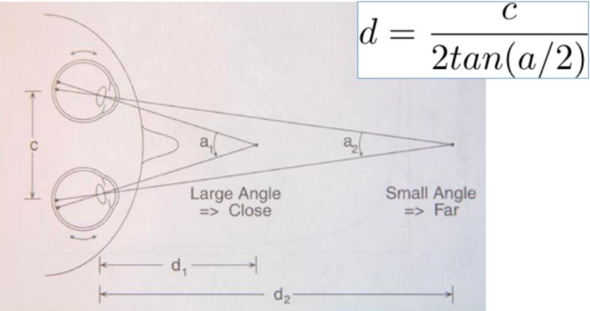

- 主动视觉传感器：系统**主动发射光**，辅助获得几何/深度信息

**机器人视觉应用：** **异常检测和图像分析**（划痕检测、土壤分析）  **物体检测和识别**（表计读数、文字识别）  **扫描测绘**（工件建模、地形测绘）  **环境理解与机器人导航**（车辆预测、场景解析）  **机器人操作**（物品抓取、工具操作）  **AR/VR**（虚拟渲染、头/手跟踪）  **其他应用、娱乐...**

**机器人视觉的挑战：低层灰度像素不稳定，几何/语义高层信息复杂，二者之间存在巨大鸿沟**

> 需要从受光照、视角、遮挡、尺度等因素影响的低层像素/灰度信息中，恢复稳定的几何信息和语义信息；而像素信息与真实世界的几何、语义之间存在较大鸿沟，同时现实场景和物体变化空间非常大。

---

## 2 相机建模与单目深度

### 图像函数

数字图像是**二维数组**

**图像是定义在CCD阵列下的离散函数**（黑白--灰度 彩色--rgb值 深度--深度值）

像素的**位置**，涵盖了**几何信息**

- 同一个物理世界的点，成像到不同图像位置，能够反映空间关系

像素的**取值**，涵盖了**灰度信息**

- 同一个物理世界的点，成像到不同图像位置，对应灰度信息类似

$$
I:(u,v)\in[0,W-1]\times[0,H-1]\rightarrow q\in\mathbb{R}^N
\\
q=I(u,v)
$$

$$
\boxed{\text{输入：像素位置 }(u,v)\quad\xrightarrow{图像函数I}\quad\text{输出：像素值 }q}
$$

> W：宽  H：高  N类似通道数

### 成像原理

在**3D**（物理世界）和**2D**（图像）之间建立相机模型

物体表面漫反射无法成像-->小孔成像（倒像）：只允许来自某个物体点的一束特定方向光线穿过小孔，到达成像平面

### 相机建模

$$
真实三维点P=(X,Y,Z)\longrightarrow x=(u,v)像素位置
$$

#### 坐标系建立

由于小孔成像为倒像，因此在小孔前建立虚拟的图像坐标系

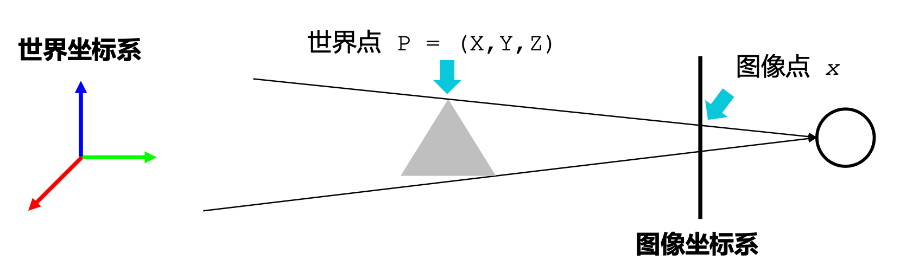

> 图像坐标系在虚拟成像平面上，相机坐标系原点就是小孔

#### 射影变换方程和相机模型

$$
\boxed{
P_w
\xrightarrow{R,t}
P_c
\xrightarrow{K}
(u,v)
}
$$

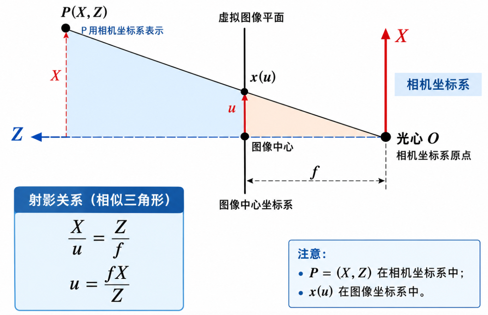

二维XZ截面向一维的u轴投影，x(u)定义在图像中心坐标系，P(X,Z)定义在相机坐标系

焦距用图像坐标系表示，f=焦距/CCD一格的X方向宽度（转换为以像素为单位）

$$
\boxed{\frac{X}{u}=\frac{Z}{f} \qquad u=\frac{fX}{Z}}
$$

$u\propto X 、u\propto \frac{1}{Z}近大远小、u\propto \frac{1}{Z}$焦距越长画面越放大（这里f也是转化为像素为单位的）

同理有$v=\frac{fY}{Z}$，因此，
$$
\boxed{
\begin{bmatrix}
u\\
v
\end{bmatrix}
=
\frac{1}{Z}
\begin{bmatrix}
f_x & 0\\
0 & f_y
\end{bmatrix}
\begin{bmatrix}
X\\
Y
\end{bmatrix}
}
$$
其中 f 均为真实焦距除以CCD一个像素物理宽度得来的像素为单位。

推广，**图像坐标系没有定义在中心，CCD中心也不可能刚好对准光心。**同样以XZ平面为例：

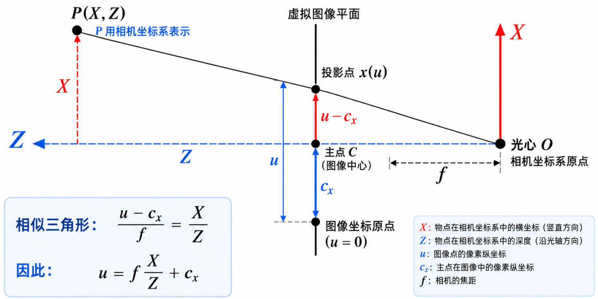
$$
\begin{bmatrix}
u\\
v\\
1
\end{bmatrix}
=
\frac{1}{Z}
\begin{bmatrix}
f_x & 0 & c_x\\
0 & f_y & c_y\\
0 & 0 & 1
\end{bmatrix}
\begin{bmatrix}
X\\
Y\\
Z
\end{bmatrix}
$$
最后，世界坐标系与相机坐标系不重合，因此要用一个旋转矩阵R和一个平移向量t，把P从相机坐标系转换到世界坐标系：$P_c=RP_w+t$。综上可以得到完整相机建模：
$$
\begin{bmatrix}
u\\
v\\
1
\end{bmatrix}
=
\frac{1}{Z_c}
\underbrace{
\begin{bmatrix}
f_x & 0 & c_x\\
0 & f_y & c_y\\
0 & 0 & 1
\end{bmatrix}
}_{\text{内参矩阵 }K}
\underbrace{
\begin{bmatrix}
R & t
\end{bmatrix}
}_{\text{外参矩阵 }T}
\begin{bmatrix}
P_w\\
1
\end{bmatrix}
$$
注意K完全相机内部参数决定，Z是相机坐标系，右侧P是世界坐标系下点坐标。

#### 镜头畸变

真实镜头并不完全符合理想小孔模型，所以还要考虑畸变
$$
\begin{bmatrix}
u_d\\
v_d
\end{bmatrix}
=
\left(1+k_1r^2+k_2r^4\right)
\begin{bmatrix}
u-c_x\\
v-c_y
\end{bmatrix}
+
\begin{bmatrix}
c_x\\
c_y
\end{bmatrix}

\qquad

r=
\sqrt{
\left(\frac{u-c_x}{f_x}\right)^2+
\left(\frac{v-c_y}{f_y}\right)^2
}
$$

> r是像素点距离主点的距离，u_d v_d是畸变后实际成像点的像素坐标，k为畸变参数

r 越大，也就是离主点越远，畸变影响通常越明显

### 相机标定

把内参矩阵 $K$ 和畸变参数合称为相机的内参，借助**外部已知尺寸的物体**来解算这些参数

#### 张正友标定法

用棋盘格作为已知尺寸的物体，利用平面特性方便求解，棋盘格的角点检测相对简单，可靠性高

**方法**：在棋盘格确定的世界坐标系下，得到**多个位姿**相机的观测，通过采集多张不同位姿的标定板图像实现。使用opencv即可。

### 外参应用

基于指定尺寸平面（$P_w,u,v$ 已知），可以估计出平面和相机的外参R , t ，也就是相机在世界坐标系下的位姿。由此，在世界坐标系下增加一个虚拟点，可以计算出它在图像中的成像。

如果是多个点，实际上是**把一个完整的三维虚拟物体投影到真实图像中**，在运动也可以。

**实际上表明，从3D到2D是可以唯一确定直接计算的，而之后的2D恢复3D不可以。**

### 降维损失

<b>成像是降维的过程，会出现损失，而我们希望从2D重建3D</b>

<b>
单目像素能确定方向，但不能独立确定深度</b>

**二维点对应了一条三维点到光心的射线**，(X,Y,Z) 和 (λX,λY,λZ) 的投影完全相同，产生视错觉。

> 为什么一般生活中，人不容易产生错觉？
>
> 人能够识别物体的语义，知道至少大致的物体三维信息

$$
\boxed{
\text{二维图像}
+
\text{先验知识/几何约束}
\rightarrow
\text{恢复部分三维信息}
}
$$

### 平面几何

#### 点线的对偶关系

\[
直线 l=
\begin{bmatrix}
a\\
b\\
c
\end{bmatrix}
\leftrightarrow ax+by+c=0,
\qquad
点U=
\begin{bmatrix}
x\\
y\\
1
\end{bmatrix}
\leftrightarrow (x,y)
\]

- 点在线上：$l^TU=0$（带入公式即可）
- 过两定点点直线：$l=U_1\times U_2$（叉乘所得同时垂直两个向量）

如果以光心来表示原点，它和$U_1,U_2$张成一个平面，此时l既表示过两点的连线，又表示张成平面的法向量。

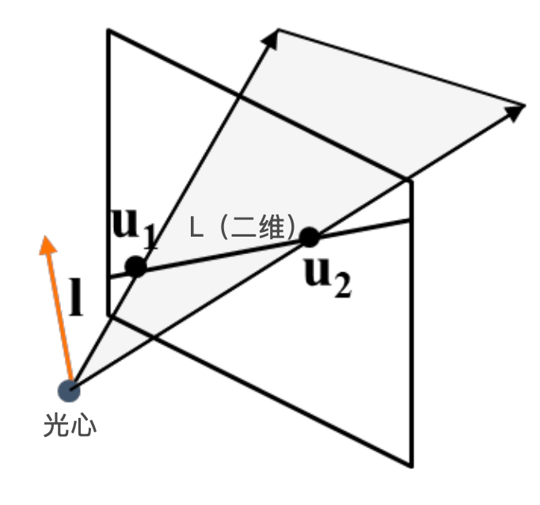

- 两直线的交点：$l_1^TU=0,l_2^TU=0 \quad因此\quad U=l_1\times l_2 $

与上面类似地，以光心为原点，两直线实际代表两个平面，他们相交成一条射线。此时U既是图像平面中两直线的交点，又表示从光心指向这个交点的三维射线方向。

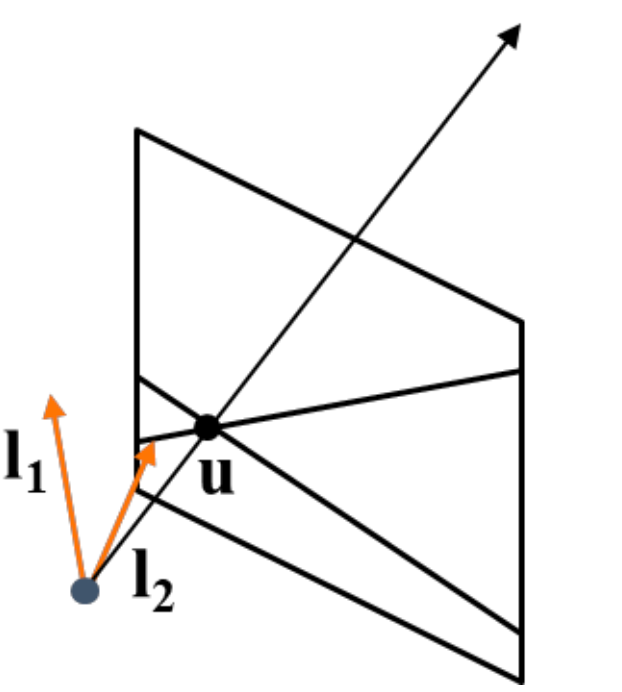

因此 $l=U_1\times U_2 \quad U=l_1\times l_2$，**点与线是对偶的，有对称性**。

#### 平行关系与三维几何

以一张图片上的矩形桌子为例，四个角点本质是四条射线，人识别出矩形桌面，本质是在无数种桌面中选择了矩形，这是符合我们认知的情况。在这个过程中，我们**通过对平面的认知，以及平行和平面关系，构建三维**。
$$
\boxed{
\text{二维投影}
+
\text{平面/平行等几何先验}
\rightarrow
\text{约束三维结构}
}
$$
针对平行的先验知识，在二维中可能出现相交，由此有消失点理论

### 消失点理论

> 平行关系是人类测量大小的重要线索，也是引起错觉的来源

空间直线上的一点P可以表示为：
$$
P=P_0+\gamma n
$$
其中$P_0$为直线上一已知点，n为方向向量。

这条线不经过光心的时候，把P点投影到图像上：
$$
U
=
\frac{1}{(P_0+\gamma n)_3}
K(P_0+\gamma n)
$$

>Ps：此处直接在相机坐标系下考虑的直线以及P，如果是世界坐标系，公式加入外参，趋于无穷之后的结果是一样的。

研究该直线向空间无限延伸的最终趋向，将$\gamma\rightarrow\infty$，有
$$
U=
\frac{1}{n_3}Kn
$$
可以发现最终点位置U与$P_0$无关，仅与直线的方向向量n相关，因此我们从光心出发做一条与该直线平行的射线，它们的交点就是无穷远点。

**无穷远点在图像上的成像位置，是通过光心、并且与这条空间直线平行的射线和图像平面的交点，这个点叫消失点**

- 空间平行线 → 图像中交于同一个消失点，近大远小
- 地面两个方向的线 → 图像中形成两个消失点 → 连接即为一条消失线--地平线

$$
\boxed{
\text{空间中的一个方向}
\longleftrightarrow
\text{一个消失点}
}
\qquad
\boxed{
\text{空间中的一个平面}
\longleftrightarrow
\text{一条消失线}
}
$$

### 视觉测量

<b>平行关系是人类测量大小的重要线索，也是视觉测量方法的基础</b>

$$
\boxed{
\text{已知长度参照物}
+
\text{平行关系}
+
\text{消失点}
\rightarrow
\text{未知长度}
}
$$

#### 二维模型

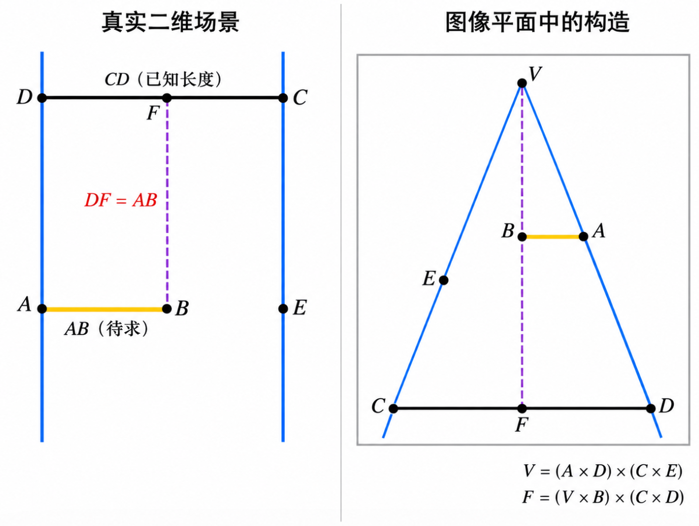

已知CD的情况下，求另一条与其平行直线AB的长度。首先连接AD，并取一点E使得CE与AD平行，两平行直线在图像平面交于一点V（消失点），连接VB并延长，与CD交于F。由消失点可知VF同样平行于AD，CE，因此ABFD为平行四边形，AB=DF进而计算出。

#### 三维问题

如图，用身高为H的人去恢复未知的柱子高度

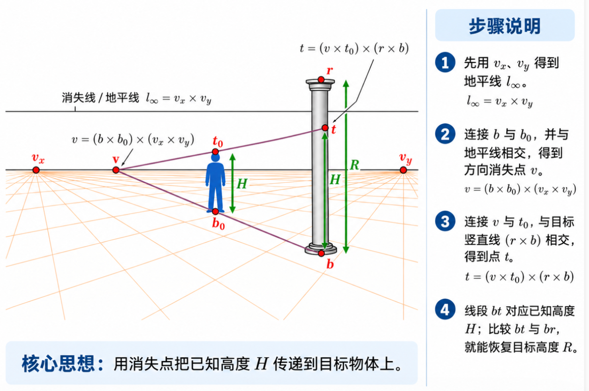

先做出地平线后，连接$$bb_0$$，他们与地平线的交点就是这个方向直线的消失点，因此可以做出他们的平行线$vt_0$.

### 单目恢复深度

$$
\text{单目三维恢复}
\begin{cases}
\text{平面/平行等相对几何关系}
+\text{已知度量物体}
\Rightarrow \text{有尺度三维}
\\[6pt]
\text{平面/平行等相对几何关系}
\Rightarrow \text{相对深度 } \lambda Z_c
\end{cases}
$$

回顾公式$$
\tilde U
=
\begin{bmatrix}
u\\
v\\
1
\end{bmatrix}
=
\frac{1}{Z_c}KP_c
$$，当整个场景同时放大，$$
\tilde U'
=
\frac{1}{\lambda Z_c}
K(\lambda P_c)=\tilde U
$$，仍然是同一点，可以反过来理解，$$P_c=Z_cK^{-1}\tilde U$$，其中$$K^{-1}\tilde U$$决定射线方向，$$Z_c$$决定沿着这个方向走多远，一个像素本身是无法得知$$Z_c$$的。

因此，我们希望通过平面**/**平行等相对几何关系，恢复**相对几何关系、相对三维结构**
$$
Z_i^{\text{恢复}}=\lambda Z_i^{\text{真实}}
$$

#### 人类知识+优化求解

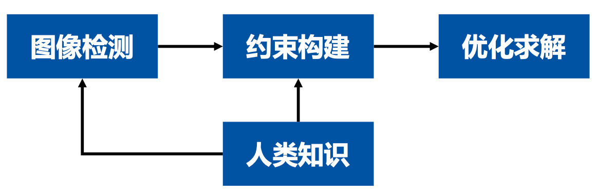

本质上求$$P = \lambda Z_cK^{-1} \begin{bmatrix} U\\ 1 \end{bmatrix}$$中的$$\lambda Z_c$$。把第$$k$$个平行、垂直等几何约束记为$$C_k(P)$$，实际优化$$\min_{\lambda Z_c} \sum_k C_k(P)$$，即**不断调整深度，让平面、平行、垂直等条件尽量成立**。
$$
\boxed{
\text{单目像素}
\rightarrow
\text{一条射线}
\rightarrow
\text{加入几何约束}
\rightarrow
\text{求出相对三维结构}
\rightarrow
\text{仍差统一尺度 }\lambda
}
$$
这个传统的pipeline逐渐受到两方面制约：如果设置线索约束？如何求解？

对于前者，部分方法探索了自动化的视觉检测分割，如法向量预测、平面预测等等，但都是基于人类简单规则来的，实际上，网络内部学习的特征不需要是人类认识的约束。

对于后者，线索→约束方程→优化器→深度的pipeline始终需要手写的求解器，约束停留在简单的平行垂直；而无论RGB值、深度值、平面平行垂直等法向量关系，都是线索的编码，对图像的表征。那为何不直接让模型学习从**RGB-->深度**呢

因此，随着神经网络发展走向了端到端的的神经网络方法。

#### 神经网络

**问题1：线索能不能自动决定？线索的表征可以人类看不懂吗？** 

RGB、深度、法向量、平面类型……本质上都可以看作图像表征。使用深度神经网络，输入RGB图像，直接学习输出线索。训练的本质就是学习这中间的映射（张量到张量的映射、表征变换）

进一步地，线索不一定是人来定义和理解的，神经网络能够学习，可以使用即可。因此后续发展端到端的情况下约束形式和求解都是网络学习决定的。**神经网络中间层是没有解码的表征**

**问题2：为什么还一定需要人工求解器？**

RGB 是一种表征；中间线索也是一种表征；深度图本身也是一种表征；

那么完全可以直接学习：**RGB表征→中间表征→深度表征**，形成端到端的单目深度。
$$
\boxed{
\begin{aligned}
\text{传统方法：}\quad
&\text{人定义线索}
\rightarrow
\text{人构建约束}
\rightarrow
\text{显式优化求解}
\\[4pt]
\text{端到端方法：}\quad
&\text{网络学习中间表征}
\rightarrow
\text{网络同时学习如何得到深度}
\end{aligned}
}
$$
**代表性工作**

- 2014：Eigen：单目图像直接恢复深度
- 2020：MiDaS系列：更大模型、**跨数据集训练**，泛化能力
- 2024：Depth Anything系列：引入仿真数据和无标签数据蒸馏

以上模型所恢复的仍然均是相对深度，人们希望通过海量训练，使图片中总有认识的物体，尺寸已知，进而得到绝对深度。这个想法在跨数据集训练的时候遇到了困难。由$$
u-c_x=\frac{f_xX}{Z_c}$$，图像尺度由 $$\frac{f}{Z}$$共同决定，与**焦距**相关。难以跨数据集训练单目有尺度深度估计，根因是焦距模糊性。

- 2023；MetricDepth系列工作：提出跨数据集焦距归一化，构造了有尺度深度估计大模型

### 小结

- 相机模型连接三维世界中的点和图像平面中的点

$$
\begin{bmatrix}
u\\
v\\
1
\end{bmatrix}
=
\frac{1}{Z_c}
K
\begin{bmatrix}
R&t
\end{bmatrix}
\begin{bmatrix}
P_w\\
1
\end{bmatrix}

\qquad
P_w
\xrightarrow{R,t}
P_c
\xrightarrow{K}
(u,v)
$$

- 三维到二维是多对一的降维过程，关键丢失的是深度。同一个图像点 $(u,v)$，反投影回去对应的是一条经过光心的射线

$$
P_c
=
Z_cK^{-1}
\begin{bmatrix}
u\\
v\\
1
\end{bmatrix}
$$

- 可以利用图像中的平行关系、消失点、消失线等人类可识别的几何约束，恢复一部分三维信息。没有已知尺度时，单目通常只能恢复相对深度，如果再加入已知度量关系，就可以恢复绝对尺度
- 深度学习把“人工设计线索 + 人工构建约束 + 优化求解”逐渐变成端到端学习

要进一步原理上解决深度问题，需要双目乃至多目视觉。

---

## 3 多目视觉与三维重建

### 双目视觉

定义$$x:=[u,v,1]^T$$代表三维点P在图像中的投影坐标，如图，P点投影到两个相机上得到$$x_1,x_2$$两个投影点。回顾相机建模：
$$
Z_c\begin{bmatrix}u\\v\\1\end{bmatrix} =K[R\mid t]\begin{bmatrix}X\\Y\\Z\\1\end{bmatrix}
$$
这里的 \([R\mid t]\) 是外参，它负责把世界坐标系下的三维点变换到相机坐标系。

以相机1的坐标系为世界坐标系，那么相机1的外参就是\[ [I\mid 0]\]；相机2相对于1有一定旋转和平移，记其外参为\[ [R\mid t]\]。

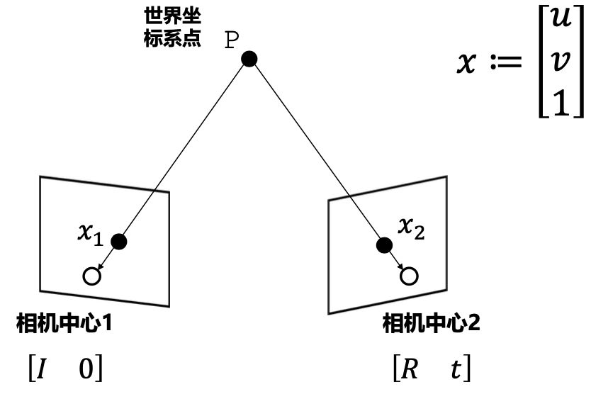

因此可以得到：\[ Z_1\mathbf{x}_1=K_1P\]，\[ Z_2\mathbf{x}_2=K_2(RP+t) \]。其中 \(K_1,K_2\) 是两台相机的内参矩阵，\(Z_1,Z_2\) 分别是同一个空间点在两台相机坐标系下的深度。因此相较于单目视觉多了一组约束，这是能够恢复深度的根本原因。

不过恢复深度我们仍需要知道**两个相机的相对位姿，并且准确找到图像中的对应点 \(x_1,x_2\)。**这便是后续**双目标定**和**极线几何**、**立体匹配**尝试解决的问题。
$$
 \boxed{\text{已知相机相对位姿 + 对应点} \;\Longrightarrow\; \text{三角测量恢复三维}} 
$$

### 双目标定

- 首先采用单目视觉的标定方法，获得两个相机各自的内参\[ K_1,\boldsymbol{k}_1,\quad K_2,\boldsymbol{k}_2 \]（小写k代表畸变系数）
- 其次求解两个相机的相对外参：使双目相机共同观测到同一个棋盘格，可以得到两个相机各自的外参，即两个相机在棋盘格定义的世界坐标系下的位姿，然后变换到两个相机的相对位姿即可。提高精度可以 a. 测多组取平均。 b. 非线性优化，以前步的结果为初值，进一步迭代提高精度

### 对应点搜索

理论上得到一组标定好的双目相机，便可以测量三维。但是对于左侧相机的一个$$x_1$$，我们不知道其真实点深度的情况下，需要在右相机图中搜索哪个点才是对应点（$$x_2$$），确定后，两条射线才能进行三角测量。不过右图可能有很多相似的像素，直接全图搜索不仅慢，也容易出错。

**极线几何告诉我们左图一个像素在右图的对应点一定落在一条线上**。

左相机光心$$O_1$$与$$x_1$$的连线一定过真实点$$P$$，而这条直线与线外的一点，右相机光心$$O_2$$构成一平面，**极平面**，与右相机图像平面相交与一条直线，即**极线**，真正的对应点 \(x_2\) 必须在这条极线上。

### 双目几何建模与极线几何

> 接下来的推导中，我们仍然保持世界坐标系与左相机坐标系重合，\(R\) 表示将相机 2 坐标系中的方向变换到相机 1 坐标系，\(t\) 表示相机 2 光心在相机 1 坐标系中的位置。为简洁，假设两个相机的内参$$K$$一致。

根据相机模型，对右侧相机2，有\[ Z_2\mathbf x_2=K\mathbf P_2 \]，深度未知时，我们把$$Z_2$$写作$$\lambda$$，即\[ \mathbf P_2=\lambda K^{-1}\mathbf x_2 \]，其中\[ K^{-1}\mathbf x_2 \]表示右相机坐标系下相机中心2到P的射线方向。把它转换到用相机1的坐标系下表示，这个方向向量为：\[ \boxed{\lambda RK^{-1}\mathbf x_2} \]

又因为在相机1坐标系中相机2中心的位置为$$t$$，因此在相机 1 坐标系下：
$$
\mathbf P=t+\lambda RK^{-1}\mathbf x_2 \quad (右相机) \qquad= \mu K^{-1}\mathbf x_1 \quad（左相机）
$$
这个公式除了\[ \mathbf x_1,\mathbf x_2,K,R,\mathbf t \]参数，还包含物体深度，在不能直接求出三维坐标时，我们先想办法消去深度$\lambda,\mu$，得到两张图像上的对应点必须满足的几何约束。

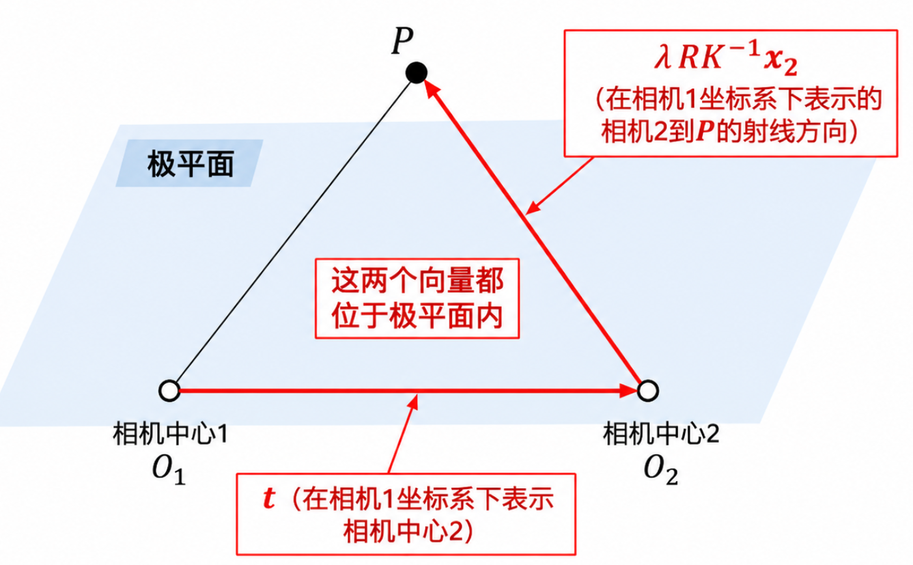

做出极平面的法向量：\[  \mathbf n = \lambda\mathbf t\times(RK^{-1}\mathbf x_2)  \]，法向量理应垂直于从左相机光心 \(O_1\) 指向三维点 \(P\) 的向量：\[  \mu K^{-1}\mathbf x_1  \]。因此有
$$
 \mathbf x_1^TK^{-T} \left[ \mathbf t\times(RK^{-1}\mathbf x_2) \right]=0 
$$
这时已经没有了深度的参数，即使不知道物体的深度，我们也可以判断两个像素是否满足双目几何约束。

公式中$$t \times R$$只由两台相机之间的相对旋转和平移决定，令它们为**本质矩阵**$$E$$，本质矩阵 \(E\) 描述的是两个相机之间的相对几何关系，不包含相机内参。实际进行对应点搜索时，我们操作的是图像中的像素坐标，而不是归一化相机坐标。因此定义**基础矩阵**：\[F=K^{-T}EK^{-1}  \]。
$$
\mathbf x_1^TF\mathbf x_2=0 
$$
观察这个式子，我们令**右图的极线参数**\[ \mathbf l_2=F^T\mathbf x_1  \]，于是：\[ \mathbf l_2^T\mathbf x_2=0 \]*（见第二章，这代表点在线上，这里便是说x2在极线上）*。也即**给定左图中的像素 \(\mathbf x_1\)，我们可以直接用基础矩阵 \(F\) 计算出右图的一条极线**。反过来同理。

### 极线约束用于匹配对应点

有了极线约束后，给定左图上一点后，只需要沿着极线寻找可能的匹配点，而不用搜索整个右图。但是即使这一条线上也可能有多个相似区域。寻找时采用**图像块相似性**来确定匹配点（不是单看一个像素，而是它和它周围一小块区域）

However，双目相机的相对位姿会影响物体的成像外观，大小形状灰度在两个相机中都可能出现差别，于是，我们进一步还需要**双目校正**、更好的匹配代价以及全局约束等方法。

### 双目校正

首先给出标准双目相机的标准相对位姿，相机1的x轴与平移共线，相平面平行。此时两台相机不再有相对旋转，相对平移：$$t=[b,0,0]^T$$，\(b\) 是两相机光心的距离，也称为基线长度。

**为什么要这个样子？**

两个光心和三维点 \(P\) 共同确定一个极平面，极平面与两个相机图像平面的交线分别就是极线。这样设置的话两条极线位于同一水平行。有$$v_1=v_2$$。后面只需要寻找水平方向上的像素差，不必再考虑垂直方向。

不过，真实世界中的双目相机未必安装得如此精确。所以，我们需要一种方法，把实际拍摄的两张图像变换成标准双目相机拍摄的效果。这就是**双目校正**。

#### 旋转图像

**转后一点在转前的成像，由于没有平移的存在，可以不需要借助深度**

依然考虑\[ \mathbf P=ZK^{-1}\tilde{\mathbf x} \]，如果此时相机仅发生旋转而不平移，考虑同一个三维点P旋转前后的成像位置。\[ \mathbf P=R'\mathbf P' \]，带入投影关系有 \[ ZK^{-1}\tilde{\mathbf x} = R'Z'K^{-1}\tilde{\mathbf x}' \]于是：
$$
\tilde{\mathbf x} = \frac{Z'}{Z}KR'K^{-1}\tilde{\mathbf x}'
$$
其中\(R'\) 表示从新坐标系到旧坐标系的旋转。

公式用的$$\frac{Z'}{Z}$$可以被归一化时消掉。在归一化图像坐标($$K=I$$)时，展开有
$$
u= \frac{r_{11}u'+r_{12}v'+r_{13}} {r_{31}u'+r_{32}v'+r_{33}}
$$

> 直观上来理解：假如 \(P\) 在距离相机 1 米的位置，和它在距离相机 10 米的位置，只要它们沿着同一条空间射线，纯旋转后，它们仍然成像在相同的像素位置。所以，计算纯旋转前后的像素位置关系，不需要知道物体深度。
>
> 但是，如果不仅发生了旋转还发生了平移，在带入公式后会有无法消去含有深度的平移项，因此不行
>
> 这里的核心就是说，如果我们只转动相机而不平移，旋转后的一个像素位置，可以直接通过原始图像坐标和旋转矩阵计算出来。

因此，在双目校正时我们会通过旋转，将实际的双目相机变换为标准的相对位姿，极线平行与**x**轴，且图像平面的旋转更一致，适合图像匹配。

### 立体匹配

经过校正后，对于左目中一点，只要在右目同一行其右侧搜索即可。对于这一行的候选点，我们常采用**计算左图一点的图像块和右图一点的图像块的差异**（**SSD**），确定最优匹配点。

> ssd:计算小范围的两侧对应像素的平方差之和

> 立体匹配应用：三维电影，本质上还是利用双目视差感知三维空间

### 深度恢复

通过前面的一系列工作，我们找到了左右图中对应点\[ (u_1,v),\quad(u_2,v) \]，视差\[ d=u_1-u_2 \]。在校正后的相机下，可以根据左右目中同一个点的视差，计算出深度。

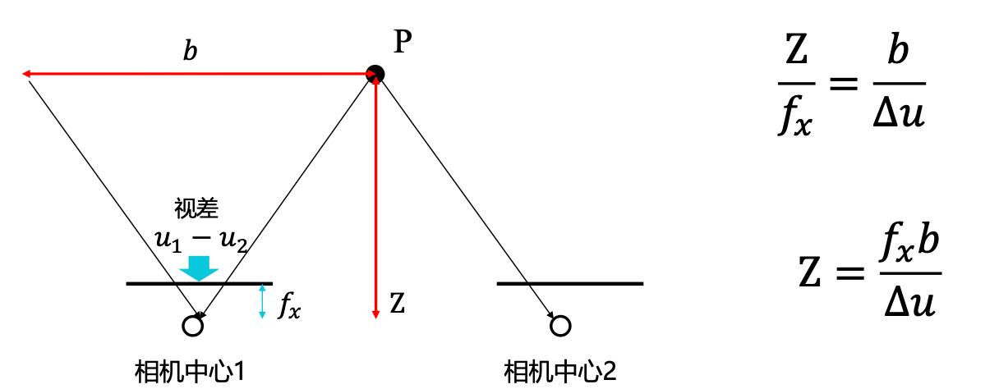

> 也可以联立\[ u_1=f_x\frac{X}{Z}+c_x \]，\[ u_2=f_x\frac{X-b}{Z}+c_x \]解出相同结果

**视差与深度成反比；已知基线长度$b$，就能够恢复有真实物理尺度的深度**

至此，我们走完了双目视觉获取深度的全流程：**双目标定得参数--极线几何约束直线--双目校正到水平--立体匹配得视差--深度恢复 从像素视差得到真实空间深度**

不过还存在一些问题例如图像块相似性不一定可靠、不同像素独立匹配容易产生噪声、远距离深度估计误差较大等等..

### 缺陷、改善与误差分析

#### 立体匹配缺陷

SSD 最小的候选点，不一定是真正的对应点。

在图像无纹理/有重复纹理等情况时，局部匹配很可能出错

#### 从局部约束改为立体匹配全局约束

我们不再单独求每个像素的最优视差，而是把相邻像素的视差一起考虑。对于每一个点，都应该有

- 左右图像块尽可能相似，即 SSD 尽可能小。
- 如果这个像素和它附近一些像素属于连续表面，它们的视差应该比较接近，应该是连续的

因此我们先求出整张图每个点在不同视差时的ssd大小，构成一张$$uv-d$$ Grid，现在每个点不仅考虑ssd大小，还考虑与周围点选择的ssd的差异。实际实现时是一个动态规划问题，既考虑图像块匹配代价，又考虑相邻像素的视差的平滑约束。

#### 误差分析

对于\[ Z=\frac{f_xb}{\Delta u} \]（ \(\Delta u\) 即视差 \(d\)），对视差求导：
$$
\frac{dZ}{d(\Delta u)} =-\frac{f_xb}{(\Delta u)^2} 
$$
一阶近似下\[ \delta Z\approx\frac{dZ}{dd}\delta d \]，\[ |\delta Z|\approx\frac{f_xb}{d^2}|\delta d| \approx\frac{Z^2}{f_xb}|\delta d|  \]

**视差越小，同样大小的视差误差引起的深度误差越大。在焦距、基线和视差误差固定时，深度误差近似正比于真实深度的平方。**越远误差越大。

### 双目测量的应用

e.g. slam \[ \text{双目图像} \rightarrow \text{深度 / 三维点} \rightarrow \text{环境几何信息} \]

### 多目视觉--多目立体视

双目视觉可能存在匹配歧义，测量精度等问题，因此自然想法为增加到多目立体视觉

- 选一张图像作为参考图
- 对参考图中的一个像素，对应空间中的一条射线，假设它具有不同的候选深度
- 把每个候选三维点投影到其他相机图像中，比较这些视角下的图像块是否一致（计算ssd）
- 将每一次匹配的**SSD**曲线叠加，得到**SSSD**曲线（**Sum of SSDs**）。选择让多视角匹配总代价最小的深度

**双目匹配是在右图中寻找对应像素，现在多目立体视觉可以直接把“候选深度”作为搜索变量。**

### 多目优势（多基线优势）

以一字排开的多个相机为例，每个相机与第一个相机之间的基线b有长有短。

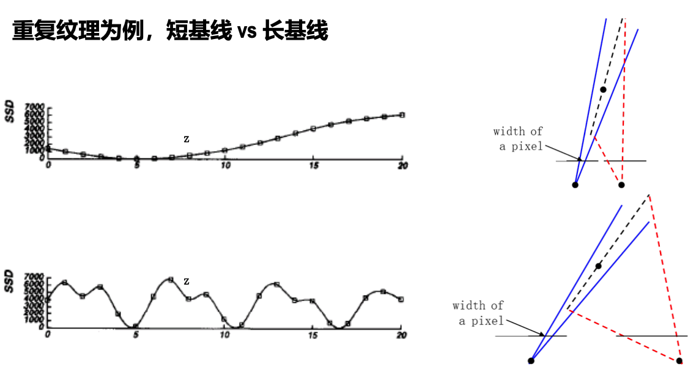

短基线：匹配容易，但深度区分能力弱。当两个相机距离很近时，视差很小，比较容易找到相似的图像块，当 \(b\) 很小时，同样的深度变化引起的视差变化也较小。这就使得 SSD 曲线的低谷比较宽、比较平坦

长基线：深度区分能力更强，但可能出现多个错误极小值。对于相同的深度变化，视差变化也更加明显。因此，正确深度附近的匹配代价曲线可能有更尖锐的低谷

因此使用SSSD进行多基线融合，可以融合优势，找到一个更加可靠的最低点。

### Plane Sweeping Stereo

- 参考图的深度估计等价于在 \(u-v-d\) Volume 中寻找一个 2.5D 表面。

- 表面所在的 Voxel 具有较低的匹配代价。

- 可以直接穷举深度并进行投影，避免传统双目校正步骤。（利用已知相机位姿直接进行投影，不要求先将所有相机变换成标准水平双目配置）

我们为每个图像像素 \((u,v)\) 枚举不同候选深度$Z$，每个 \((u,v,Z)\) 都对应一个候选三维位置。对于参考图中的每个像素 \((u,v)\)，我们只需要选择一个最佳深度：\[ Z^*(u,v) \]，所有选中的位置连在一起形成一个表面。（说的寻找2.5D表面，是因为只描述参考视角所见的表面，并没有恢复物体全部背面和被遮挡的结构）

在plane sweeping中，不只是逐个像素独立考虑，而是直接考虑一整个平面，按照深度平面把其他视角的图像按照这些平面投影到参考视角，再检查图像是否对齐。

### 立体视的缺陷

基线过大时可能导致视野被遮挡，SSD 无法衡量匹配点的相似性。

### 立体视学习

> 对于没有纹理的区域，能否利用学习得到的先验知识来恢复深度？

在单目时，模型可以从训练数据中学习物体形状、空间结构、语义等先验知识。多目视觉一样，即使某些区域的多视角纹理匹配不可靠，我们仍然可能依靠学习到的结构先验提供辅助信息。直接学$Z_c$
$$
\min_{Z_c} \left[ \sum_k C_k(Z_c)+SSSD(Z_c) \right]
$$
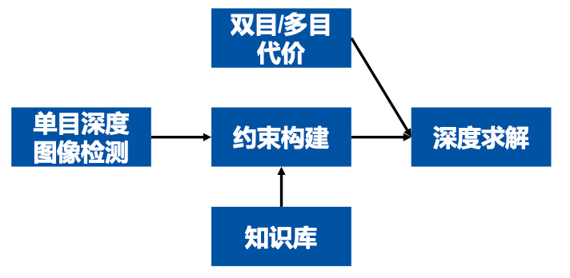

进一步自然便是把显式几何约束直接改成端到端的神经网络，这个时候需要考虑：如果只是简单地把多张图像送入神经网络，相机之间的几何关系怎么办？也就是——多目图像和相机位姿应该怎样输入神经网络？

图像信息和相机之间的位姿是异构的，二者维度差异很大，但是如果只给图像会丢失位姿几何信息。以下为两个解决办法

#### MVSNet

在多帧图像的特征图上构建**Plane Sweeping**，将位姿信息和图像信息联合表征到**Cost Volume**，满足几何约束。

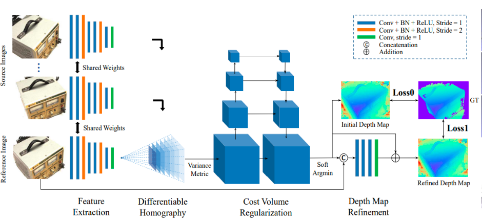

先用神经网络抽取特征之后，对特征图做Plane Sweeping，然后构建cost volume。

并不是完全让网络从零学习多视角几何，而是把已有的投影几何关系嵌入网络结构中，再学习如何完成特征匹配和深度估计

#### PointMVSNet

将点云作为表征，从而将三维空间的先验考虑到立体视恢复，避免了深度图表征的误差局限性

（先获得初步的多视角深度估计，再利用点云的三维几何信息进一步优化）

### 结构光与深度学习

深度不一定能准确测出来？-->主动向物体投射纹理，或者利用神经网络补全缺失的深度。

**结构光：主动打光，形成纹理，引导双目的匹配**
$$
\text{主动投射已知图案} \rightarrow \text{观察图案的成像} \rightarrow \text{计算深度} 
$$

#### 深度补全

当一个深度传感器能够直接测出部分像素的深度，但存在很多缺失区域时，把原始的稀疏深度当做一种约束，结合单目深度恢复求解。

- 结合**RGB**和不完整的视差，输出完整的视差，进而恢复深度

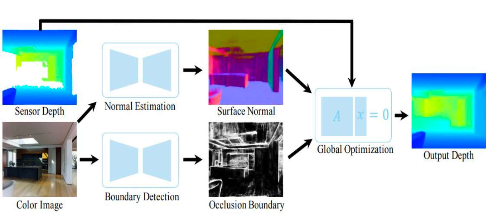

- 从更底层的红外图像直接回归，构建带有红外结构光纹理的仿真数据集，训练神经网络并迁移到实物

$$
 \text{带有投射纹理的红外图像} \xrightarrow{\text{神经网络}} \text{深度} 
$$

### 从深度图到完整三维重建

一张深度图只能描述从某个视角能够观察到的表面，虽然将深度图反投影得到的是三维坐标，但本质上依然只能描述当前视角所看到的那一层表面。也就是**2.5**维表征，一张深度图未必能表征一个三维物体。

**显式的三维表征：点云或者网络（mesh）**

- 点云：直观，数据结构简单。但是难融合且缺少拓扑信息，离散点没有显式表示这些点之间应该如何连接。
- Mesh不仅记录点的位置，还记录点之间的连接关系。包含顶点，边，面

**隐式三维表征：隐函数，符号距离场（SDF）**

隐式表示定义一个空间函数：\[ f:\mathbb R^3\rightarrow\mathbb R \]，给定空间中的任意一点 \(\mathbf x\)，函数会返回一个数值。然后通过这个数值描述物体的几何形状。

SDF就是空间点到物体表面的带符号距离

可以先通过隐式函数对点云进行多帧融合，再从隐式函数中提取 Mesh

**完整的三维重建系统：**

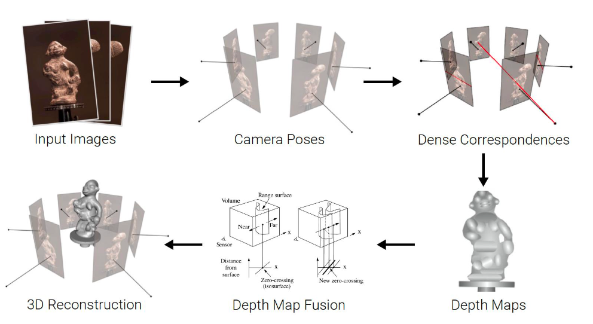

**Occupancy grid 用栅格表示三维空间**

- occupancy grid：把空间划分为大量小格子，每个格子可以存储是否被占据，或者被占据的概率。这样机器人就可以判断空间中哪里可能存在障碍物。但是栅格的分辨率越高，需要存储的体素就越多
- 八叉树 Octree：自适应划分方法，不需要精细表示的空间，使用较大的体素；需要精细描述几何结构的区域，继续把体素细分。因为是三维的，每一次划分是1个大块变8个小块。

但 Occupancy Grid 主要描述空间是否被占据，对精细连续表面的表达能力仍然有限。

**在栅格上定义 SDF**

传统占据栅格通常存储一个格子是否被占据。但如果希望更精确地知道物体表面在哪里，仅靠一个占据状态还不够。因此可以在离散网格上保存符号距离值。

**TSDF 截断符号距离函数**

只重点保留表面附近一定范围内的距离信息，靠近表面的区域，保存较精细的距离值。

真实深度传感器往往只能观察物体的一部分，得到的表面并不一定封闭，因此难以在整个空间中可靠定义“物体内部”和“物体外部”。TSDF 通过强调观测表面附近的局部有符号距离，解决**SDF**函数难以表征非水密表面问题。

**利用多张深度图构建TSDF**

每张深度图为体素提供一个观测。每一张深度图可以为一个真实位置点提供一个深度估计，但不同帧的观测质量可能不一样，因此引入权重，加权融合即可（可递归，来一张做一张）

**从TSDF提取三维表面**

得到融合后的TSDF后，寻找 TSDF 从正值变到负值的位置，即零交叉：\[ \text{多帧深度图} \rightarrow \text{TSDF 融合} \rightarrow \text{零等值面} \rightarrow \text{三维表面}  \]

### 小结

- 根据人眼获取深度的启发，构建了一套**双目相机**系统

- 结合成像原理和单目标定，导出了**双目标定**的方法

- 为了简化搜索和匹配，介绍了**标准位姿**，以及导出标准位姿的**双目校正**

- 以双目之间的基线长度为度量，能够实现对匹配点的**深度恢复**

- 引入**多目**能够对匹配模糊和测量精度实现进一步提升

- 通过设计位姿和图像表征，能够利用海量数据训练多目**网络预测**深度

- 通过隐函数**TSDF**，能够融合多帧深度点云，获得更好的表面

>  双目标定、MVS、Plane Sweeping 和 TSDF 融合，都不同程度地依赖相机之间的相对位姿。对于固定双目相机，可以提前标定。但如果机器人拿着相机在未知环境中运动，**位姿从何而来？**

## 4 特征提取与匹配

> 在相机位姿未知、图像外观发生变化的情况下，怎样可靠地找到两张图像中对应的同一个物理点？
>
> 和《机器人学2》第7章的视觉里程估计内容有重合

> 哪些点值得匹配？——关键点检测
>
> 怎样判断两个关键点是不是同一个物理点？——描述子
>
> 怎样从大量候选匹配中找出正确对应关系？——特征匹配

### 图像匹配

- 目的：位姿未知的图像匹配，对 N 个像素中的每个像素，寻找另 N 个像素中的匹配
- 挑战：计算量大，位姿、光照、环境变化和遮挡...
- 简单的图像块相减匹配不能解决位姿、光照、环境变化和遮挡等问题。
- 解决办法：关键点提取（$$N \to K$$个点）；关键点描述和匹配（$$K \times K$$）

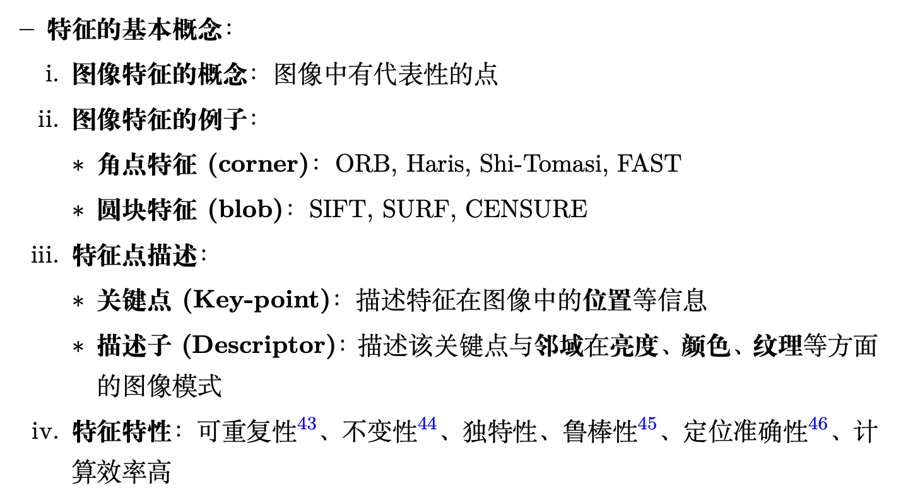

图源考拉的机器人学2复习提纲P65 [ac01]

### 关键点

- 优点：减少数量，匹配容易，不易造成混淆
- 为了对环境变化、遮挡以及少量位姿变化鲁棒，仍需采用**局部图像块**而非单个像素
- 关键点在局部具有**独特性**，例如**角点区域**而非平坦/边缘区域
- **独特性**：一张图中的点在另一张图中局部不混淆，沿不同方向移动局部图像都会明显变化

#### 从图像梯度到 Harris 角点

**如何数学上衡量独特性？—— 梯度--泰勒展开--M矩阵**

##### 梯度

回顾图像函数的定义：\[ I(u,v) \]，其中 \(I\) 表示像素灰度值，\(u,v\) 是像素坐标

定义两个方向的偏导数：\[ I_u=\frac{\partial I}{\partial u}, \qquad I_v=\frac{\partial I}{\partial v} \]。由于数字图像是离散的，所以实际计算中常用差分近似。课件采用的是前向差分：

\[ I_u(u,v)=I(u+1,v)-I(u,v)\]     \[ I_v(u,v)=I(u,v+1)-I(u,v)\]

即：向右/向下移动一个像素，灰度值改变多少

##### 泰勒展开

对某一个像素位置$$x=[u,v]^T$$，移动很小位移$$\delta=[\Delta u,\Delta v]^T$$，考虑移动前后的灰度变化：$$[I(x+\delta)-I(x)]^2$$

对于二维函数 \(I(u,v)\)，在 \(x\) 附近进行一阶泰勒展开:
$$
I(u+\Delta u,v+\Delta v) \approx I(u,v)+I_u\Delta u+I_v\Delta v  \approx I(x)+\nabla I^T\delta \text{(向量形式)}
$$
其中图像梯度\[ \nabla I= \begin{bmatrix} I_u\\I_v \end{bmatrix} \]。因此\[ I(x+\delta)-I(x)\approx \nabla I^T\delta \]，有
$$
[I(x+\delta)-I(x)]^2 \approx(\nabla I^T\delta)^2 \quad \text{(图像块的变化估计)}
$$

##### M矩阵

现在考虑一个\(5\times5\) 的图像窗口 \(W\)而非一个点。它包含 25 个像素，每个像素都有自己的梯度：\[ \nabla I_i= \begin{bmatrix} I_{u,i}\\I_{v,i} \end{bmatrix} \]。我们希望计算整个窗口平移 \(\delta\) 后的灰度变化。

将窗口中所有像素的灰度变化平方加起来：
$$
E(\delta)= \sum_{x\in W} [I(x+\delta)-I(x)]^2 \approx \sum_{x\in W}(\nabla I^T\delta)^2 \approx \delta^T \left( \sum_{x\in W}\nabla I\nabla I^T \right)\delta
$$
定义
$$
M=\sum_{x\in W}\nabla I\nabla I^T  = 
\begin{bmatrix}\sum I_u\\\sum I_v\end{bmatrix}
\begin{bmatrix}\sum I_u&\sum I_v\end{bmatrix}
= \begin{bmatrix} \sum_W I_u^2 & \sum_W I_uI_v\\ \sum_W I_uI_v & \sum_W I_v^2 \end{bmatrix} 
$$
于是有
$$
E(\delta)\approx\delta^TM\delta
$$
M矩阵是实对称矩阵，半正定矩阵，是点局部图像的二次型近似，**能反映整个窗口对不同平移方向的敏感程度。**

> 考虑以下两个例子：
>
> \[ M= \begin{bmatrix} 3&0\\ 0&3 \end{bmatrix} \]，代入公式，\[ E(\delta)= \begin{bmatrix} \Delta u&\Delta v \end{bmatrix} \begin{bmatrix} 3&0\\0&3 \end{bmatrix} \begin{bmatrix} \Delta u\\\Delta v \end{bmatrix} =3\Delta u^2+3\Delta v^2 \]。无论向哪个方向平移，局部灰度变化就会增加，这正是角点的特征；
>
> \[ M= \begin{bmatrix} 3&0\\ 0&0 \end{bmatrix} \]，\[ E(\delta)=3\Delta u^2 \]。水平移动时变化大，竖直移动时几乎不变。它就对应一条竖直边缘。
>
> 因此，**\(M\) 矩阵包含了区分角点和边缘所需要的信息**。
> 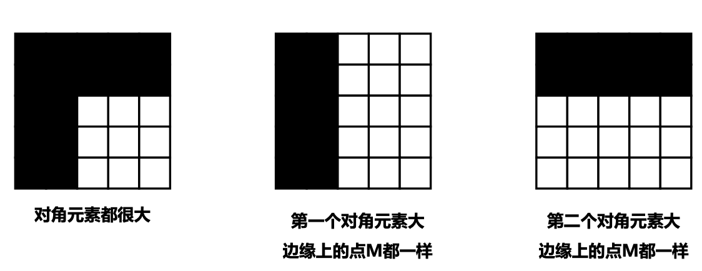

不过，这里还需要考虑一个问题：真实图像中的边缘和角点不一定沿着水平、竖直方向。我们不能只观察 \(M\) 的两个对角元素，还需要一种与图像旋转方向无关的分析方法。于是接下来就要引入矩阵的特征值。

不过，这里还需要考虑一个问题：真实图像中的边缘和角点不一定沿着水平、竖直方向。

我们不能只观察 \(M\) 的两个对角元素，还需要一种与图像旋转方向无关的分析方法。

于是接下来就要引入矩阵的特征值。

**M的特征值具有旋转不变性**

图像旋转时的梯度变化：：\[  \begin{bmatrix} \tilde I_u\\ \tilde I_v \end{bmatrix} = R \begin{bmatrix} I_u\\ I_v \end{bmatrix}  \]，其中\[ R= \begin{bmatrix} \cos\theta&-\sin\theta\\ \sin\theta&\cos\theta \end{bmatrix} \]。

那么旋转后的M矩阵：\[ \tilde M= \sum_{x\in W} \widetilde{\nabla I} \widetilde{\nabla I}^{T} =  \sum_{x\in W} (R\nabla I)(R\nabla I)^T =R MR^T\]

因此旋转矩阵是正交阵：\[ R^TR=I \]、\[ R^T=R^{-1} \]。根据线代有\(M\) 矩阵的**特征值**对图像**旋转具有不变性**。

因此在判断角点的时候我们应该用特征值而不是直接看\(I_u,I_v\)。

##### 利用特征值进行判断

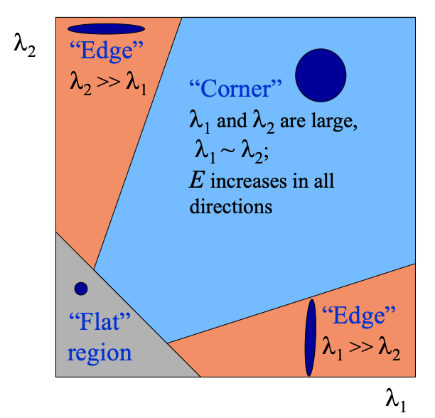

> 由于 \(M\) 是实对称矩阵，可以进行正交特征值分解：\[ M=Q \begin{bmatrix} \lambda_1&0\\ 0&\lambda_2 \end{bmatrix} Q^T \]，令：\[ \delta'=Q^T\delta \]有\[ E(\delta)\approx \lambda_1(\delta'_1)^2+ \lambda_2(\delta'_2)^2 \]。所以特征值表示沿着两个相互正交的主方向移动时，局部图像变化的敏感程度。也就是说，看特征值和看$I$其实一样，都是找两个都很大就OK了

$$
\boxed{\text{角点检测的核心：寻找两个特征值都比较大的位置。}} 
$$

> 例：棋盘格角点检测
>
> 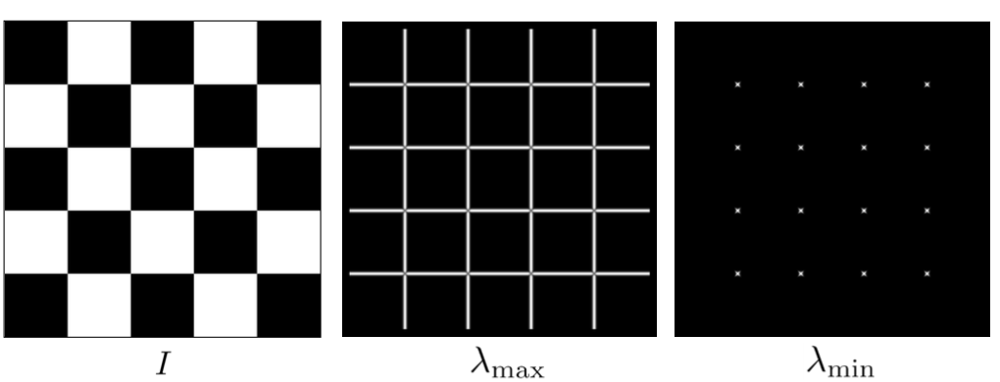
>
> 右边两张图分别表示最大特征值/最小特征值很大的区域。
>
> 只看最大特征值很大不代表一定是角点，可能是边沿
> 但是如果最小特征值都很大，两个方向都存在明显的灰度变化。那么它就很可能是角点了

##### Harris角点

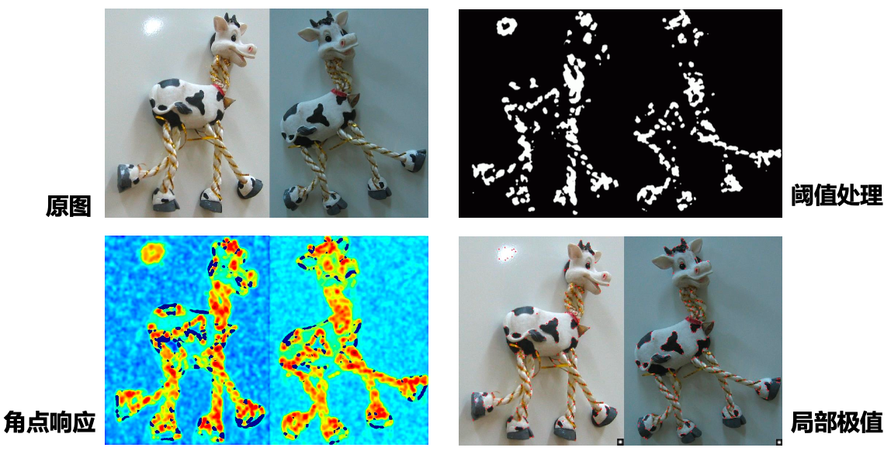

> Harris角点法不直接计算M的特征值，而是定义一个角点响应函数，角点区域函数值较大，超过设置阈值的位置作为候选角点。之后做一下非极大值抑制，在一个局部只留局部最大值作为候选（真实角点周围像素的值也较高），输出最终的角点。

#### 角点的性质

> 角点经过平移、旋转、光照、尺度、姿态变换后是否还是角点？

定义：\[ h(x)=H(I(x)) \]，理解为对原图像 \(I\) 应用特征检测算子 \(H\)，在位置 \(x\) 获得响应 \(h(x)\)

现在图像发生了变化：

- \(W\)：几何变换，例如平移、旋转、缩放。
- \(A\)：外观变换，例如光照强度变化。

经过变换后，我们在对应位置计算新的特征响应 $h'(W(x))=H(A(I(W(x))))$

我们希望满足$h'(W(x))=h(x)$，即检测对这种变换具有稳定性，角点变换后仍然是角点。

**Harris角点的性质：**

- Harris 角点对平移、旋转、一定程度的光照变化具有不变性（Invariance & Equivariance）

- 对尺度变化没有不变性，对图像块尺寸敏感

> 注1：Invariance指不变性，指输入发生某种变化，但我们关心的特征值或判断结果保持不变。例如旋转图像后，\(M\) 的特征值保持不变；Equivariance指等变性，指输入发生变化，输出也按照可预测的规律发生变化。例如关键点坐标不应该保持在原来的位置，而应该跟随图像几何变换
>
> 注2：Harris角点不变性关注M（M特征值不变即可），例如光照，如果是整体变化那么梯度不变，但是如果是不均匀变化导致梯度变化，那么M变化，角点响应大小随之改变，因而写的一定程度的光照变化。
>
> 注3：Harris角点对尺度变化没有不变性，例如在相机离物体拉远时，同一个角点在图像中变得很小，原来窗口中可能只包含一个清晰的角点，现在却可能包含角点周围更多的结构，或者角点已经小到受到模糊影响。因此，计算出来的 \(M\) 矩阵和角点响应都可能发生变化。受这个问题的启发，固定窗口大小会导致尺度不变性不足：-->

#### 带尺度的角点

既然固定窗口大小会导致尺度不变性不足，那么一个自然的解决办法就是：**在不同尺度下检测角点**

遍历尺度，取同样的图像块尺寸（检测窗口），等价于用不同尺寸的图像块提取角点响应。因此可以构造多尺度图像，并在每个尺度下计算角点响应。

可是一个角点可能在多个尺度下都存在，究竟应该选择哪个尺度作为它的特征尺度？——Automatic Scale Selection自动尺度选择

**自动尺度选择：**对于一个局部结构，用不同大小的尺度去分析，存在某个尺度，使得特征响应特别明显，就选择这个最明显响应对应的尺度。

> 实际自动尺度选择必须使用适合跨尺度比较的响应，通常还涉及尺度归一化

**Harris角点 + 尺度选择 = 图像块尺寸自适应的Harris角点**，这样获得了尺度不变性。

现在是否已经可以匹配了？怎样衡量两个角点是否属于同一个世界点？衡量角点的性质将使用第二个核心概念：描述子。

### 描述子

从Harris的角点响应函数和角点对应的图像块（自适应尺度后）引入：

- 角点响应：有不变性；没有全局独特性（角点的函数值都很大），非角点的点没有局部独特性
- 角点对应图像块：平移不变，姿态有一定不变性，但对旋转、光照等没有不变性；有全局独特性（排除重复纹理情况）

我们兼顾二者性质，基于角点的图像块，设计具有不变性的描述子。

> 通过尺度选择，解决了不同大小的图像块如何归一化的问题后，我们还需要再看看旋转问题，还需要旋转归一化。
>
> 之前在旋转时我们推导了\[ \tilde M=RMR^T \]，经过旋转，M的特征值不变，但是对应特征向量是变化的。因此，在主方向能够稳定确定的情况下，我们可以利用特征向量提供方向信息（角点响应隐含计算了旋转。）
>
> 但是虽然 \(M\) 蕴含方向信息，Harris 算法并没有直接告诉我们角点的主方向是多少度。（估计算法不计算特征向量）
>
> 解决办法：在下面的MOPS描述子中，直接利用局部图像梯度，或者统计图像块内的主导梯度方向，为每个关键点指定一个方向 \(\theta\)。然后按照这个方向旋转并对齐图像块。

#### Multiscale Oriented PatcheS Descriptor（MOPS描述子）

主方向对齐，尺度自适应的图像块描述子。核心：**既然不同的图像块会发生缩放和旋转，那就先把它们对齐，再比较。**

怎样确定图像块的主方向？

- 直接采用局部梯度方向\[ \theta=\operatorname{atan2}(I_v,I_u) \]
- 使用局部图像块中的主导梯度方向（图像块内的众数方向）

确定主方向之后就可以将多张图片旋转到同一方向了。

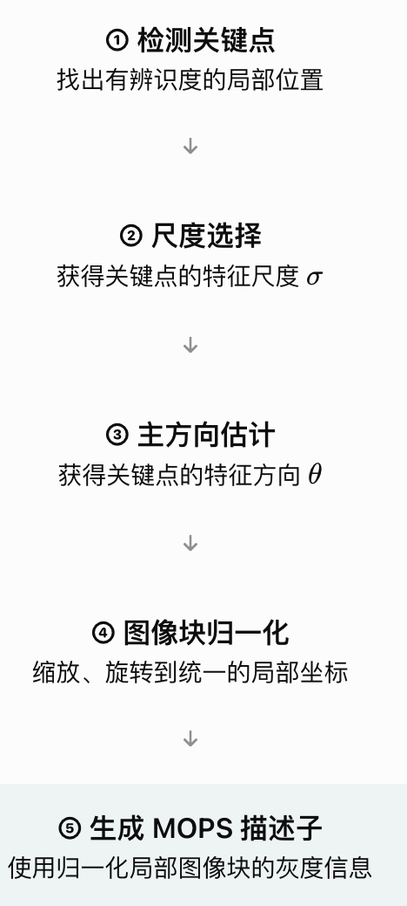

一张图片**->** 一组角点和对应描述子，逐一比对描述子的相似性即可实现匹配。但是MOPS同样存在问题：对光照缺少不变性，对姿态变化同样不稳定（三维观察例如同一个窗户，正面看是矩形，斜着看会呈现梯形。这种变换并不能仅靠二维旋转和缩放完全抵消）

#### 梯度直方图

**用图像块中像素的离散梯度方向直方图代替原始像素值，提升描述子对光照的不变性，构成描述子。**

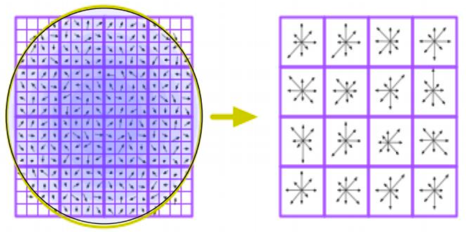

#### SIFT（Scale Invariant Feature Transform尺度不变特征变换）

**多尺度 + 主方向对齐 + 梯度直方图 = SIFT描述子**

> 输入关键点及其局部图像——根据特征**尺度**确定局部支持区域——估计**主方向**并进行方向对齐——划分子区域并计算**梯度方向直方图**——输出归一化的描述子向量（经典形式为 128 维）

从直接描述像素的亮暗，转向描述局部图像结构的方向分布，这也是SIFT描述子与MOPS的区别和优势。

### 特征匹配

在前面我们通过特征提取，已经将N个点的图片提出K个特征点（具有不变性、局部独特性、描述子即特征（有多种不变性和全局独特性））

\[ F(x_{\mathrm{Harris}})=SIFT(I(x_{\mathrm{Harris}})) \]（对于检测到的一个 Harris 角点，可以利用其周围的局部图像信息构造 SIFT 描述子），现在在特征匹配我们需要把两张图的K个特征进行比对：
$$
\text{最近邻匹配}\rightarrow\text{Ratio Test}\rightarrow\text{学习型描述子}\rightarrow\text{学习型匹配}
$$

#### 最近邻匹配

$$
 x'=\arg\min_{y\in\mathcal K_2} \|F_1(x)-F_2(y)\|_2 
$$

对于图 1 中的一个特征点，找到图 2 中描述子最接近的那个特征点。

**问题：**重复纹理。我们需要关注的不是找\[ d(F,F')\text{ 很小} \]，这只说明相似度高，更重要是\[ d(F,F')\ll d(F,F'') \]，代表匹配没有歧义，这是ratio test出发点

#### 相对度量方案Ratio

阈值，通常取**0.7-0.9**，它要求最接近的描述子，要比第二接近的描述子接近很多，以解决重复纹理带来的问题

\[ d_1=\|F(x)-F(x')\|_2 \] 最近邻，\[ d_2=\|F(x)-F(x'')\|_2 \] 次近邻，计算：\[r=\frac{d_1}{d_2} \]小于阈值时才接受这组匹配。

当然，特征匹配同样发照向了深度学习的方法

#### 基于学习的特征匹配

- SIFT梯度直方图高度人工设计，对于姿态变换等复杂情况，真的是最优么？2017年，尝试利用神经网络直接作为描述子提取的工具，产生了显著效果（主要改变描述子提取）
- 传统匹配独立对待每一个像素的匹配，缺少高阶关系的考虑，在图1的相邻像素大概率匹配图2的相邻像素，2019年SuperGlue，将关键点间的关系也考虑到匹配中，通过**GNN**进一步提升了效果（改进匹配策略）
- 2021年，神经网络同时提取特征和特征匹配。通过逐像素匹配，避免显式考虑关键点，将提取特征和匹配两者结合。

> 特征提取和匹配工具：常用OpenCV做特征提取、匹配

### 小结

- 将图像匹配问题转化为关键点匹配问题，通过关键点减少匹配的混淆性，同时减少匹配的计算复杂度
- 基于角点响应能够体现局部的独特性，由此导出**Harris**角点
- 通过对尺度、旋转、平移、光照、姿态等一系列因素的不变性分析，采用角点图像块的自适应，并采用梯度直方图，导出**SIFT**描述子
- 通过**Ratio Test**解决了重复纹理导致的混淆问题，提高匹配的正确率
- 学习的引入，实现了特征匹配从稀疏到稠密，从独立到高阶

现在，我们已经得到一组组对应的匹配点，他们对应同一组世界点。如果已知两张图像之间的一组特征匹配，如何反过来求解两次拍摄之间的相对位姿 \(R,t\)？这便是第五章位姿估计与重建的主要关注问题。

## 5 位姿估计与重建

> 第三章研究双目视觉时，通常假设两台相机之间的相对位姿已知，例如经过双目标定。如果只有不同位置拍摄的几张图片，相机之间的相对位姿还不知道，能不能反过来利用图像匹配求出位姿，再恢复三维场景？实现SfM（Structure from Motion）

### 从特征匹配到两帧位姿估计

> 已经有了第四章的特征匹配，如何排除错误匹配？
> 得到可靠匹配后，如何恢复两个相机之间的相对位姿？

#### 剔除错误的特征匹配——RANSAC

第四章中讲到特征匹配，ratio test，但是即使经过 Ratio Test，仍然可能出错，需要剔除。

回顾第三章本质矩阵和相关公式：
$$
\mathbf x_1^T K^{-T}EK^{-1}\mathbf x_2=0 \qquad E=[t]_\times R
$$

> 已经忘完了，回顾一下几何意义：令归一化图像坐标：\[ \hat{\mathbf x}_1=K^{-1}\mathbf x_1,\quad \hat{\mathbf x}_2=K^{-1}\mathbf x_2 \]。如果这两个图像点对应同一个三维物理点，那么两条观察射线与两个相机中心之间的平移向量必须位于同一个极平面。
> 
>
> \[ \hat{\mathbf x}_1^T \left(t\times R\hat{\mathbf x}_2\right)=0 \]，又定义\[ t\times v=[t]_\times v \]，得到\[ \hat{\mathbf x}_1^T[t]_\times R\hat{\mathbf x}_2=0 \]。这就是本质矩阵约束。

正确匹配应当符合统一的极线几何关系，错误匹配通常不符合。因此离群点不符合本质矩阵E关系，但问题是我们既不知道错误匹配也不知道本质矩阵E。

位姿估计的主要难点在于，离群点并不是零均值的高斯噪声（例如正确匹配的两边微小的误差），可能是全图像均匀分布的噪声（错误的匹配可能飞了很远，错的很多）。（因此不能简单的用什么最小二乘来解决问题）

采用**随机采样一致性RANSAC**剔除错误匹配 Random Sample Consensus：

> 概括：既然不知道哪些匹配正确，那就不断随机抽取少量匹配建立模型，再用所有匹配检验哪个模型最可信。

> 具体流程：
>
> **随机采样：**在样本集中随机抽取**8**个样本，所抽取样本集合称为**S**，基于**S**中的样本进行**E**的估计。（注：8其实是8点估计算法所需的最小匹配数，在求解E的时候8个点可以保证一般情况得到一个非零解）
> **模型验证：**计算样本集中其他样本是否满足本质矩阵方差，误差小于设定阈值的样本集**S**构成内点集合**S\***，**S\***是**S**的一致集(Consensus Set)。计算**S\***的大小，保留到目前为止估计得最好的模型**S\*** （一致集最大）
>
> 输出**S\***，基于**S\***估计**E**（最小二乘解），得到位姿

**成功率公式：**
$$
P=1-(1-w^n)^K
$$
其中 \(w\)：匹配点中正确匹配所占比例。\(n\)：每次建立模型需要抽取的匹配数。上述使用 \(n=8\)。\(K\)：随机采样的次数。\(P\)：至少有一次采样全部抽中正确匹配的概率

> 注：推导
>
> 一次采样的 \(n\) 个点全都是正确匹配的概率近似为：\[ p_{\text{good}}=w^n \]
> 因此，一次采样没有全部选对的概率：\[ p_{\text{bad}}=1-w^n \]
>
> 假设各次随机采样独立，连续进行 \(K\) 次，都没有抽到一组全正确样本的概率：\[ P_{\text{fail}}=(1-w^n)^K \]。于是，至少有一次成功的概率就是：\[ P=1-(1-w^n)^K \]。

我们需要达到一个成功率P的话，可以反解迭代次数：\[ K\geq \frac{\ln(1-P)}{\ln(1-w^n)} \] 高质量匹配($\omega$高)很重要!

#### 本质矩阵位姿估计（2D-2D）

经过RANSAC，我们得到了一个本质矩阵\[ E=[t]_\times R \]，现在便是从E解出R与t。可以看出肯定不是唯一解。

**问题：**

- 平移尺度不确定：齐次方程，如果\[ t'=\lambda t \]，新的E仍然满足极线约束。因此我们up-to-scale，通常将 t 标准化为某个元素为1。
- 即便考虑Up-to-scale，仍有多组解。从本质矩阵进行分解时，通常可以得到：两种候选旋转 \(R_1,R_2\)；两种候选平移方向 \(+t,-t\)。组合出四组候选位姿，需要进一步挑选。
  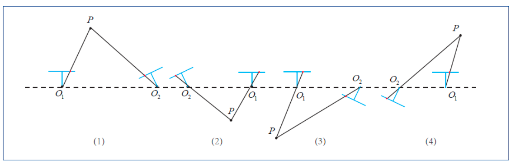

> RANSAC 不是特征匹配算法，而是利用几何模型剔除错误匹配的鲁棒估计方法。
>
> 本质矩阵 \(E=[t]_\times R\) 将二维对应点与相机相对位姿联系起来。
>
> 2D-2D 位姿估计能够恢复旋转和平移方向，但无法恢复真实平移尺度。

- 特征提取和匹配应用：物体样例识别和定位，服务于操作
- 位姿估计工具：**OpenCV**提供了相应的库，例如`cv2.findEssentialMat()` `cv2.recoverPose()`

### 特征点三角化

得到一组R，t后，可以按照双目求解的方法，去做第三章做过的一系列（双目校正--视差--深度公式）来恢复深度，也可以直接求解，用最小二乘法求解

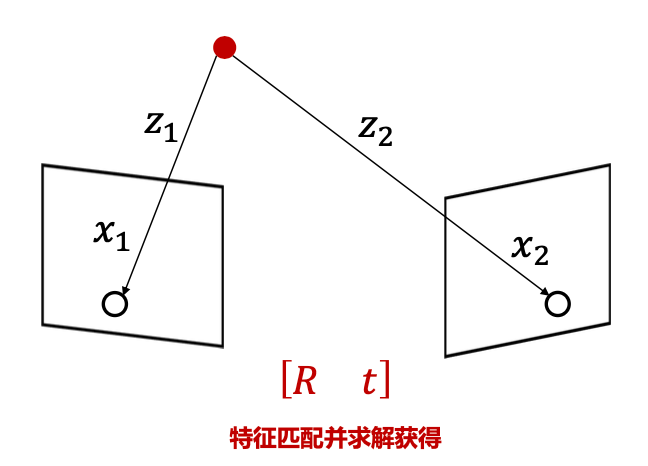
$$
z_1K^{-1}\mathbf x_1 = Rz_2K^{-1}\mathbf x_2+t
\quad \text{即}

\begin{bmatrix}
K^{-1}\mathbf x_1 & -RK^{-1}\mathbf x_2
\end{bmatrix}
\begin{bmatrix}
z_1\\z_2
\end{bmatrix}
=t
$$

> 注：推导：
>
> 由\[ z\begin{bmatrix}u\\v\\1\end{bmatrix} = K\begin{bmatrix}X\\Y\\Z\end{bmatrix} \]即\[ z\mathbf x=KX \]，得到\[ X_1=z_1K^{-1}\mathbf x_1 \]，\[ X_2=z_2K^{-1}\mathbf x_2 \]。代入\[ X_1=RX_2+t \] 即可。

$z_1,z_2$是未知数，有 3 个标量方程，用最小二乘法求解即可。

> 注：这里两种方法均为恢复相对深度，相对3D位置。本质上是我们不知道平移尺度，只知道$$\lambda t$$的大小。对第一个方法，校正后获取深度时要用的基线长度$$b$$同样由$$t$$算来的。

### 第三张图位姿估计 2D-3D

通过两个相机图像，我们可以获得特征匹配，得到对应点。估计本质矩阵 \(E_{12}\)。恢复相对位姿 \(R_{12},t_{12}\)。三角化恢复三维点 \(X\)。现在第三张图像来了，我们知道这个三维点在第三张图中的成像位置 \(x_3\)。

- 想法：如果直接对第一张、第三张图像再做一次 2D-2D 位姿估计？
- 问题：尺寸不统一，我们并不知道两次的t真实的比例是多少。
- 解决方法：利用第一张图和第二张图算出的三维特征点，估计第三张图的位姿，从**2D-2D**问题，转化为**3D-2D**问题，通过**3D**保持尺度一致（还是相对尺度，相对尺度一致）

#### P3P (2D-3D)

存在3D位置情况下，理论上给定3对匹配即可求得与3D位置尺度一致的位姿该问题称为P3P问题，存在几何求解方法。（把1 2图片算出的世界点拿3个去和图片3匹配，算出图片3在这个尺度下的R，t）

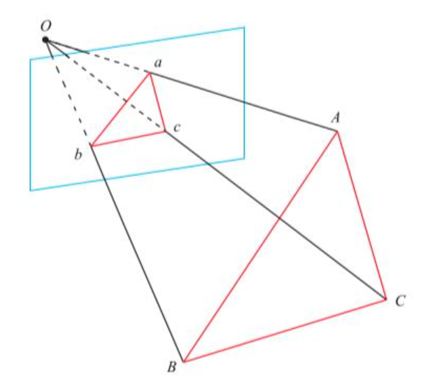

> 已知：
>
> - 三个三维点 \(A,B,C\) 的世界坐标。
> - 三个对应的二维图像点 \(a,b,c\)。
> - 相机内参 \(K\)。
>
> 未知：
>
> - 相机的位置。
> - 相机的旋转方向。
>
> 也就是需要求出：\[ R\in SO(3),\qquad t\in\mathbb R^3 \]

几何解：**余弦定理**。

图像点 \(a,b,c\) 已知，相机内参也已知，所以可以恢复三条观察射线的方向，例如：\[ d_a=K^{-1}\tilde a \]。因此可以算出两两射线的夹角，再代入三个余弦定理
$$
OA^2+OB^2-2OA\cdot OB\cos\theta_{ab}=AB^2
\\
 OB^2+OC^2-2OB\cdot OC\cos\theta_{bc}=BC^2 
 \\
 OA^2+OC^2-2OA\cdot OC\cos\theta_{ac}=AC^2 
$$
解出$$OA,OB,OC$$，结合每个像素对应的观察射线，就可以确定三个三维点在相机坐标系中的位置。然后以A点为例，$$A_{\text{相机3}}=RA_{world}+t$$，以及另外两组相同形式约束，恢复相机位姿

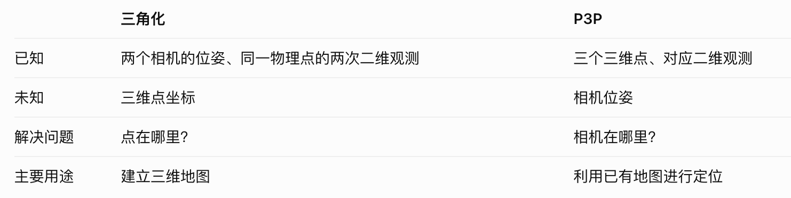

#### 2D-3D位姿RANSAC

以下是2D-2D的流程

> **随机采样：**在样本集中随机抽取**8**个样本，所抽取样本集合称为**S**，基于**S**中的样本进行**E**的估计。（注：8其实是8点估计算法所需的最小匹配数，在求解E的时候8个点可以保证一般情况得到一个非零解）
> **模型验证：**计算样本集中其他样本是否满足本质矩阵方差，误差小于设定阈值的样本集**S**构成内点集合**S\***，**S\***是**S**的一致集(Consensus Set)。计算**S\***的大小，保留到目前为止估计得最好的模型**S\*** （一致集最大）
>
> 输出**S\***，基于**S\***估计**E**（最小二乘解），得到位姿

这里的修改：

- 8个点样本改成3个点（因为做P3P三个点就OK）
- “基于**S**中的样本进行**E**的估计” 改成 “利用 P3P 估计候选位姿 \(R,t\)“

> 注：实际上，验证也需要改（没有提到）从极线约束改成将三维点重新投影回图像，对比与真实的图像上二维点的重投影误差。

- P3P 无法直接推广到最小二乘解，OpenCV 提供了相应的库，如`cv2.solvePnP()` `cv2.solvePnPRansac()`

对于以下三种方法：

- 第一/二张图2D-2D，三角化重建，2D-3D求解第三张图
- 第一/三张图2D-2D，三角化重建，2D-3D求解第二张图
- 第二/三张图2D-2D，三角化重建，2D-3D求解第一张图

三种做法数值上不会一样，因为每次用2个图求出的全局尺度不同。即使把尺度统一了，如果考虑特征点匹配存在的像素误差，三种方式的估计结果还是会存在不同，因为，用哪两张照片初始化，就会主要受到哪两张图片误差的影响。

### 位姿估计与三维重建的联合优化

上一节我们发现不同图像对初始化，经过尺度和坐标系对齐后，结果仍可能由于像素误差而不一致。那么一个很自然的想法就是直接把所有图像的观测信息放到一起，统一优化。

- 问题：如果有多幅图像同时观测到同一个特征点，如何获得一致的最优的重建？
- 方法：回归相机模型，给定相机下求解特征点三维。

**特征点三角化/地图恢复**

两视图三角化中我们用\[ z_1K^{-1}x_1=Rz_2K^{-1}x_2+t \]，其实就是利用两条射线求交点。现在我我们有X个相机发出的X条射线，要求他们的交点（有误差），是一个最小化问题，ppt上公式等价于：
$$
\min_X\sum_j
\left\|
x_j-\pi(K(R_jX+t_j))
\right\|^2
$$
其中 \(X\)：我们要求解的三维点。\(R_j,t_j\)：第 \(j\) 台相机的位姿。\(x_j\)：在第 \(j\) 张图像中实际观测到的像素位置。\(\pi(K(R_jX+t_j))\)：根据当前三维点和相机位姿，计算出的预测像素位置。其实\[ e_j=x_j-\pi(K(R_jX+t_j)) \]就是第j张图的重投影误差，我们要寻找使得总误差最小的三维点

注意这里是相机位姿 \(R_j,t_j\) 被视为已知且固定，利用所有观测优化三维点。（先用2D-2D得X，然后P3P得其他R t，然后再做这里和后续去优化X以及R t）

**位姿估计**

三维点经过优化，发生了变化，通过三维点求解的位姿也会发生变化。因此我们重新利用所有的正确匹配三维点，估计每个相机的位姿。

ppt公式等价于：
$$
\min_{R,t}
\sum_i
\left\|
x_i-\pi(K(RX_i+t))
\right\|^2
$$
所以，三维点改变，相机位姿改变。相机位姿改变，三维点又改变。是循环迭代的。
🤔既然三维点和相机位姿本来就相互关联，为什么不直接将它们放进同一个优化问题中？⬇️

**集束调整（Bundle Adjustment，BA）**

将原本分别求解的未知量放进同一个整体优化问题。等价为非线性优化相机位姿和特征点的 3D 位置
$$
\min_{\{R_j,t_j\},\{X_i\}}
\sum_{(i,j)\in\mathcal V}
\left\|
x_{ij}-\pi(K(R_jX_i+t_j))
\right\|^2
$$

- BA工具：Colma，解决完整的Structure from motion问题
- BA可稀疏重建点云，可多相机推广。

> 注：应该我们仅凭单目多视图的重投影误差做 BA，仍然是存在全局尺度不确定性的

### 基于学习的SFM

传统SFM的路径是特征匹配——位姿求解——多目线索——深度恢复。图 **=>** 特征匹配，匹配 **=>** 位姿，图**/**位姿 **=>** 三维

- 问题1：能否直接从图像预测三维结构？
- 问题2：如果让神经网络直接预测三维，输出应该是什么？

- 2023年，提出采用 **Pointmap**，即相机1坐标系下相机2的逐像素三维点，作为监督，该表征包含了深度和匹配，或深度和位姿。
- 2024年，提出同时采用 **Pointmap** 和匹配进行监督，同时考虑几何和图像线索。（网络在原有的 3D Head 之外，增加了 Descriptor Head，除了几何信息加回了部分特征信息）
- 2025年，**VGGT** 将图片从两帧拓展到多帧，端到端 SFM，结合 BA。尝试直接利用多张图像的信息进行联合预测。端到端从图像到深度图，准确地说是 2.5 维（只有当前相机视角下可见的表面）
  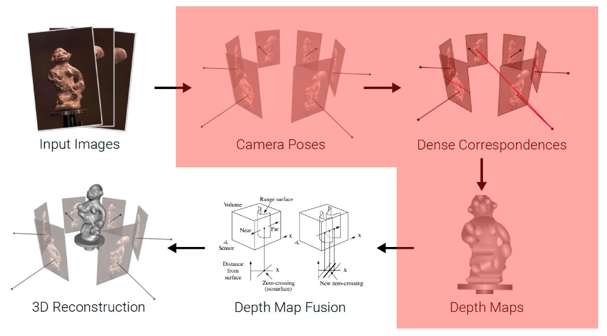

- 进一步端到端从图像到三维表征。端到端三维重建，结合增量式设计。
  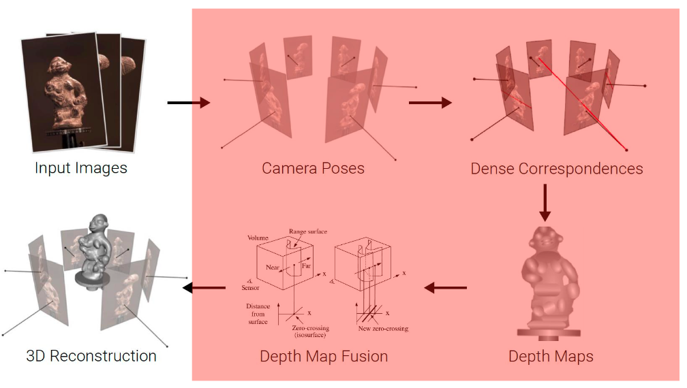
  （红色是被网络替代的部分）

### 小结

- 利用图像特征匹配，通过2D-2D计算两帧图像的相对位姿，进而通过双目原理，三角化计算特征的三维，即重建，但Up-to-scale
- 推广到多帧图像，如果重复利用两帧图像的思路，会引起尺度不一致问题，采用2D-3D计算第三帧以后得位姿，保持尺度统一，但仍Up-to-scale
- 不同顺序求解多帧图像，会导致结果并不一致，通过BA同时求解所有相机位姿和所有特征点三维，能够保证一致且提高精度
- 神经网络预测**Pointmap**，实现两帧端到端重建，后续研究发现保持多个任务对精度有帮助，推动了端到端重建，通过BA后处理也能提高精度

AI总结版：

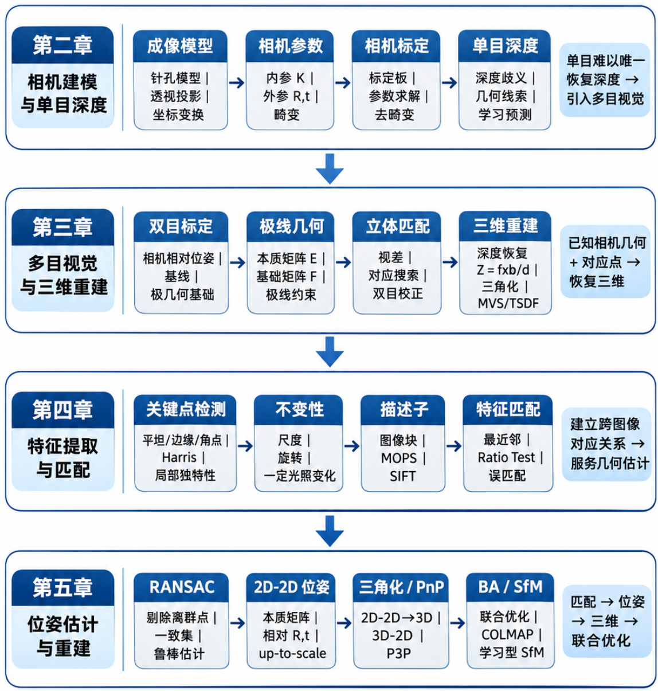

## 6 基于传统图像处理的目标识别

> 前五章研究的是几何视觉，主要是图像和真实点的关系，第六章重点是如何处理提取图像中的目标

### 前言

#### 空间感知和语义感知

机器人视觉借鉴人类视觉（两个视觉通路）：

- 背侧视觉：空间感知，运动、深度、形状
- 腹侧视觉：类别&语义感知
- 空间感知增强语义感知语义感知促进空间感知，二者相辅相成

#### 视觉传感器与环境间的关系

|     划分依据     |      视觉传感器**静止**      |   视觉传感器运动   |
| :--------------: | :--------------------------: | :----------------: |
| 环境目标**静止** | **目标识别**：分类 检测 分割 | 视觉定位、视觉建图 |
| 环境目标**运动** |  视频监控、行为分析、流水线  | 目标追踪、视觉伺服 |

### 图像处理基础

#### 概述

- 传统图像处理任务的一般流程
  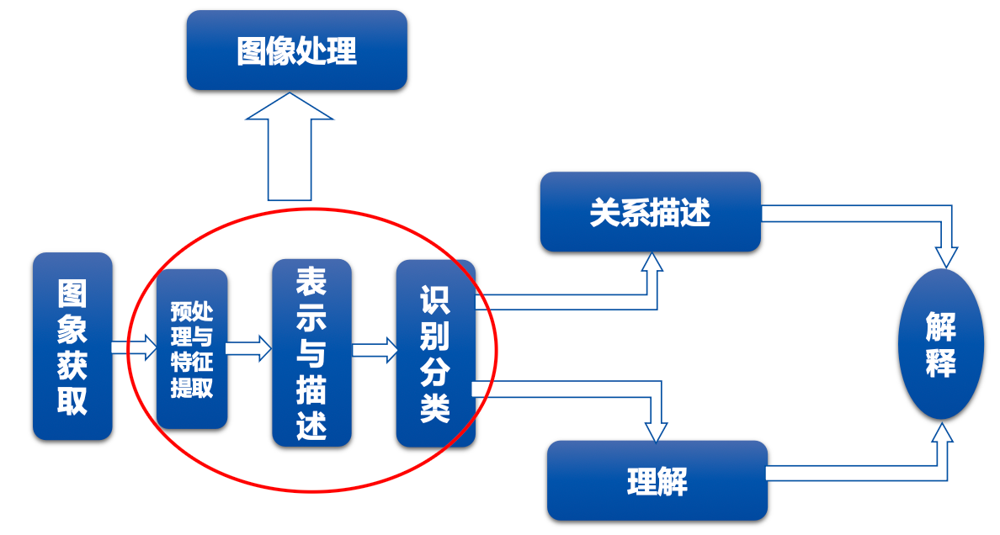
- 图像处理系统的基本构成：待测目标、光源、镜头、相机、图像采集卡、图像处理软件、输入输出板卡、工业电脑（除前两者之外，其余都可高度集成在工业相机中）

#### 待测目标

- 图像处理系统的应用分类：测量、定位、检测、分类
- 测量  e.g. 长度与角度、圆弧及半径
- 定位  内部定位、坐标输出定位
- 检测  产品与包装合规检测、行人检测、瑕疵检测、人员着装与行为检测
- 分类  条形码、二维码检测、OCR (Optical character recognition) 字符识别、颜色分类

#### 光源

- 定义：为确保视觉系统正常成像，获得足够光照信息和稳定图像而提供的照明装置
- 目的：
  - 照亮目标，提高目标亮度
  - 形成最有利于图像处理的成像效果
  - 克服环境光干扰，保证图像稳定性
- 重要性：合适的光源可以大大降低图像处理难度，提高系统检测精度、运行速度及工作效率。光源**使用得当**非常重要
- 分类：荧光灯、卤素灯+光纤导管、LED光源、激光、紫外光、自然光源
- 对比：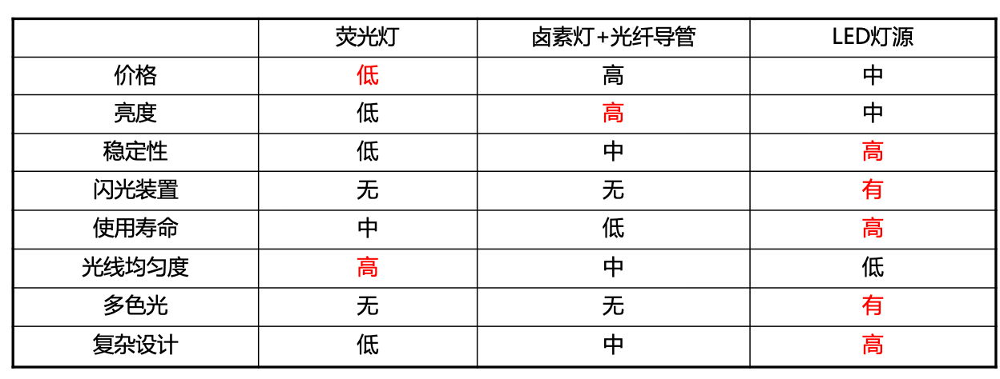
- 照明规则：
  - 功能：以一定方式照射目标物
  - 太暗（曝光不足）、太亮（过曝）：影响视觉系统
  - 要解决的主要问题：减少噪声和干扰
  - 有效的光线：来自于目标并到达镜头
  - 杂散光：进入镜头但非来自于目标，降低图像质量
  - 来自目标任意点的光线都应充分进入镜头
- 光路原理：照相机并不能看见物体，而是看见从物体表面反射过来的光（镜面/漫射/发散反射）
- 常用照明技术：
  - 背光——测量系统的最佳选择，边缘清晰
  - 亮场（左）——适合有光滑表面的照明 （表面-镜面反射，文字-漫反射）
    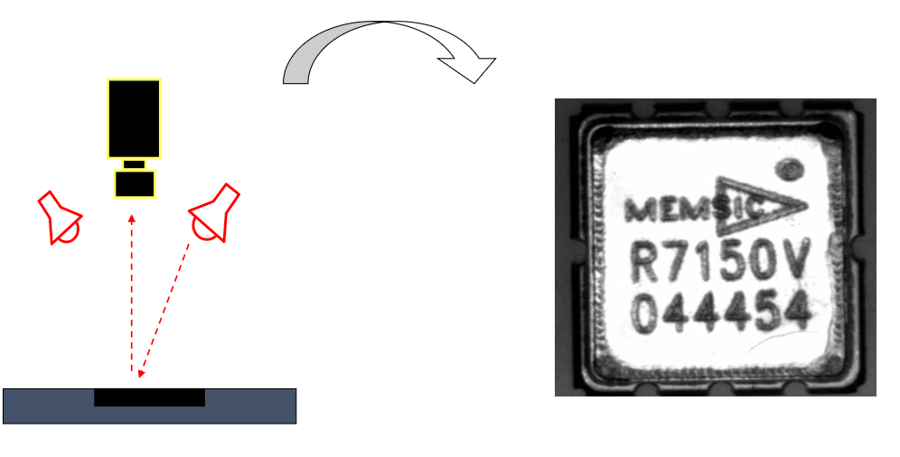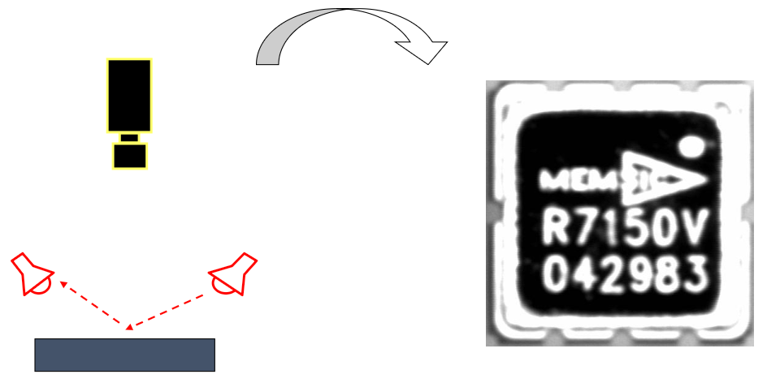       
  - 暗场（右）——适合有光滑表面的照明 （镜面反射不进相机）
  - 同轴光——均匀性好 （用50%分束片，一半透射一半折射）
  - 结构光——最简便的三维测量（RGB-D相机深度测量原理）
  - 影子的利用——间接法测量（e.g. 待测物高度、长度信息）
  - 彩色的考虑：光的三原色：红、绿、蓝；色彩三原色：青、紫、黄。世界上所有颜色都是由三原色按不同比例组合而成。三原色的色光叠加为白光。如：日光，三原色的色彩叠加为黑色

#### 镜头

- 基本功能：实现光束变换，将目标成像在图像传感器的光敏面上
- 镜头与相机匹配：
  - 镜头接口是否为工业标准接口，C (f 17.526) /CS (12.52)接口、F口（通用型接口，f>25mm的镜头）等
  - 镜头成像面>=相机CCD尺寸
- 工作距离：镜头的焦距f要适合系统工作空间
- 系统精度：影响因素：视野、镜头畸变、镜头分辨率
- 纵深成像：考虑是否在镜头景深范围之内
- 常用镜头：CCTV（便宜）、专业摄影、远心镜头（平行光路设计，在一定的物距范围内，使得到的图像放大倍率不会变化，适用于被测物不在同一平面）

#### 相机

- 分类：
  - 按芯片技术：CCD/CMOS 
  - 靶面类型：面阵/线阵相机
  - 输出模式：模拟/数字
  - 颜色模式：彩色/黑白
  - 处理器：智能/非智能
- 特性参数：感光芯片类型与参数、分辨率（位于CCD&CMOS芯片上的像素个数）、速度、**快门类型**（全局快门global shutter；卷帘快门rolling shutter）、光学接口（C CS F等）
- 分辨率：相机物理分辨率（X方向）＝最佳视野范围（X方向）/ 理论象素值（X方向），Y同理，一般用X\*Y方向的像素值作为相机分辨率（720P---1280\*720）
- 速度相关：
  - 系统单次运行速度 = 系统成像速度 + 系统检测速度
  - 帧速或线数（高速相机：每秒1000~10000帧）
  - 快门速度（运动物体检测）
  - 快门类型：果冻效应、运动模糊

#### 图像数据

- 广义图像：辐射强度模式的空间分布。（图像表达函数：辐射能量在空间分布的函数）
  - 类别：按光谱（γ 射线图像、X射线图像、紫外线图像、可见光图像、红外线图像...）  按数据类型（3D图像、彩色图像、多光谱图像、立体图像和多视图像、序列图像...）

- 图像的表达
  - 模拟：从连续的客观场景直接观察到，用一个2-D数组 *f* (*x*, *y*) 来表示，值域是实数
  - 数字：把连续的模拟图像在坐标空间*X*、*Y*和值空间*F*都离散化了的图像，值域整数

> 图象还包括图形，比图像的含义更广

- 图像数字化：将现实世界中的视觉信息转换成数字形式的过程（**采样 量化 编码**）
  - 采样：将连续的视觉信号转换为离散的像素点，每个采样点就是一个像素，采样的密度决定了图像的分辨率。密集的采样可以提高图像质量和细节表现。
  - 量化：将采样后得到的连续数值转换为离散的数字值的过程。量化的精度决定了图像的色彩深度或灰度级别，通常以位数表示（8位--256级灰度，24位--3通道的真彩色）
  - 编码：将量化后的数字值以一定规则存储或传输的过程 PNG无损、JPEG有损
    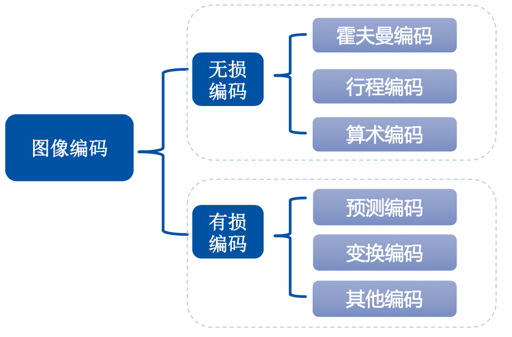

- 数字图像的空间分辨率：可见细节的能力或图像的清晰度水平，通过像素密度（每单位长度包含的像素数量 dpi/ppi）描述。空间分辨率越高，图像中的细节就越丰富，清晰度越高
- 图像灰度级：每个像素点的亮度级别（8位灰度--0-255），灰度级越大存储空间越大
- 图像深度：每个像素点所能表示的颜色或亮度的精度（8位-256种颜色 32-有透明度信息）
- 图像的表达：矩阵/矢量（矩阵的每一行/列）/离散点集/覆盖区域/
- 常规图像分类：
  - 二值图像：只有两个可能灰度（通常 0黑 和 255白）
  - 灰度图像：灰度级别更多，通常是256个灰度级（8位灰度）
  - 彩色图像：多通道，最常用是RGB三通道，每个通道有自己的灰度级和深度
  - 高深度图像：深度超过8位的图像
- 像素间的联系：
  - 邻域关系：
    - 邻接：a在b的邻域中
    - 连接：和*q*邻接且灰度值均满足某个特定的相似准则
    - 连通：不（直接）邻接，但均在另一个像素的相同邻域中，且这3个像素的灰度值均满足某个特定的相似准则。（*p*与*q*连接，*q*与*r*连接，那么*p*与*r*连通）
    - 通路：*p*和*q*间有一系列依次连接的像素使得*p*和*q*是连通的，像素构成通路
  - 距离关系：（D角标是范数）
    - 欧式（直线距）\[ D_2(p,q)=\sqrt{(x_1-x_2)^2+(y_1-y_2)^2} \]
    -  城区：\[ D_1(p,q)=|x_1-x_2|+|y_1-y_2| \] （上下左右4邻域移动）
    - 棋盘：\[ D_\infty(p,q)=\max(|x_1-x_2|,|y_1-y_2|) \] （8邻域移动）

### 图像预处理

#### 概述

- 定义：利用计算机技术对输入的图像进行各种操作和变换，以获得特定的视觉效果或者实现特定的目标。
- 基本操作：图像变换、灰度变换、图像滤波、图像增强。

#### 图像变换与灰度变换

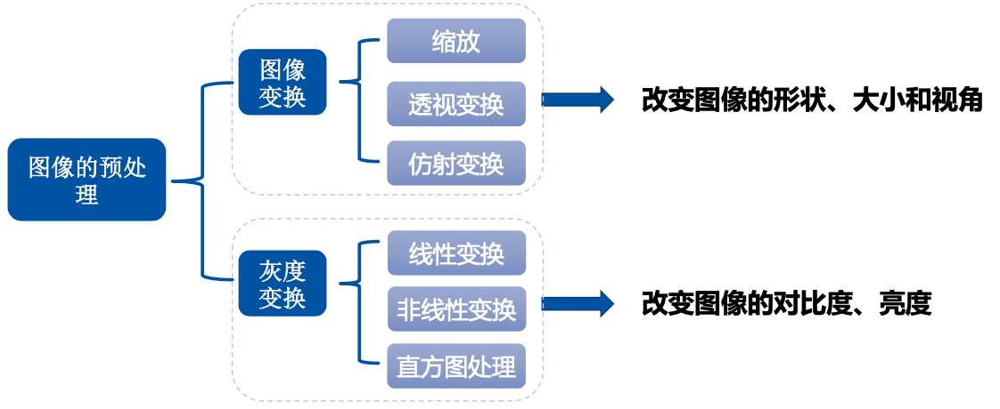

- 缩放：改变图像的尺寸大小，重新分配像素。最近邻插值、双线性插值和双三次插值等
- 仿射变换：通过线性变换和平移来改变图像形状和位置。二维坐标--二维坐标，保持图形平直性和平行性。可表示成坐标乘以一个矩阵（线性变换），再加上一个向量（平移）的形式。
- 透视变换：将图像投影到一个新的视平面，用于校正图像的透视畸变或创建虚拟视角。用一个透视变换矩阵来描述，其中的每一列代表了新坐标系中的一个基向量。（相较于仿射变换，平行线经过透视变换后不一定平行，仿射变换是透视变换的一种特殊情况）
- 线性灰度变换：通过线性函数 \[ g(x,y)=a f(x,y)+b \]  对图像的灰度级进行变换，常用于调整图像的对比度和亮度。灰度拉伸、灰度压缩和灰度反转三种基本形式
- 非线性灰度变换：调整图像的对比度、亮度和色调等特征（对数/幂律/S形曲线变换..）

#### 图像滤波

在图像上应用各种滤波器来改变图像的外观和特征，直接影响到后续图像处理和分析的有效性和可靠性

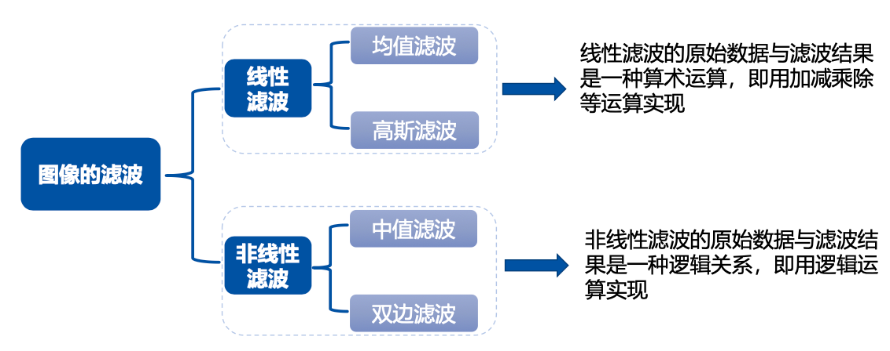

- 均值滤波：将目标像素替换为邻域内像素的平均值，计算简单，易于实现，用于平滑图像和降低噪声。

- 高斯滤波：去除高斯噪声。基于二维高斯核函数，用一个模板（卷积、掩模）扫描图像中的每一个像素，用模板确定的邻域内像素的加权平均灰度值去替代模板中心像素点的值（距离中心越近的像素，对中心像素的影响越大）

- 中值滤波：将像素的值替换为其邻域像素的中值，消除孤立噪声点。

- 双边滤波：结合图像的空间邻近度和像素值相似度，同时考虑空域信息和灰度相似性，达到保边去噪的目的。滤波器的核由两个函数生成：空间域核和值域核。两个模板相乘得到了模板权值

  > 高斯滤波考虑离中间越近权重越大，但是如果现在都中间正好在物体边缘，那可能旁边像素差异很大。双边既考虑像素空间距离又考虑像素值是否接近，越接近权重越大

#### 图像增强（增强图像的可视化效果）

通过各种算法和技术，改善或提高数字图像的质量、清晰度、对比度、亮度、颜色等方面的处理过程。方法包括灰度变换、滤波、直方图均衡化、锐化、颜色增强等。

- 直方图均衡化：重新分配图像的灰度级别，使得图像的直方图变得更加均匀。以此调节亮度、对比度，增强细节特征，本质还是根据直方图做线性或非线性灰度变换。

  > 图像灰度直方图用于反映图像中各个灰度级别的分布情况，横坐标代表图像的灰度级，纵坐标代表每一灰度值在图像中出现的次数或者频率。直方图分布范围越广，表示图像的对比度越高。

  > **步骤**：统计直方图，计算累计分布函数CDF，计算灰度映射函数H，映射得均衡后图像

### 图像特征检测

#### 概述

- 图像特征：泛指图像中有比较明显特点的基本单元（边缘、角点、直线段、圆、孔、椭圆以及它们的组合）
- 图像特征检测：用于识别图像中的结构信息，对图像分析有重要作用

> 第六章用于目标识别的特征，与第四、五章用于视觉里程计的特征有什么区别？
>
> 第四、五章主要使用局部特征（Local Features），重点是找到不同图像中同一个物理点的对应关系，再估计相机位姿。而本章强调更大范围的结构信息，例如区域、边界、连通性、形状和特征之间的关系

- 图像梯度：图像灰度值变化的方向和速率  \[  \nabla f(x,y)= \begin{bmatrix} \dfrac{\partial f}{\partial x}\\[4pt] \dfrac{\partial f}{\partial y} \end{bmatrix} \]（连续），\[ G_x\approx f(x+1,y)-f(x,y) \]  \[ G_y\approx f(x,y+1)-f(x,y) \]（离散）。梯度的幅值表示图像中的亮度变化强度，梯度的方向表示亮度变化方向。

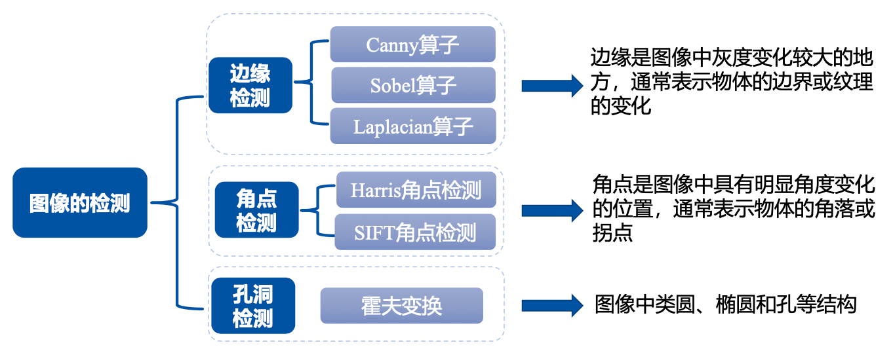

#### 边缘检测

边缘是图像最基本的特征之一，像素灰度有阶跃变化或屋顶状变化的那些像素的集合，包括灰度级的突变、颜色的突变、纹理结构的突变等。（使用一阶微分算子来检测图像边缘）

- 水平/垂直微分算子：\[ \nabla_x f=f(x+1,y)-f(x,y) \]  \[ \nabla_y f=f(x,y+1)-f(x,y) \]

  获得图像在水平以及垂直方向上的变化率，导数运算可以通过相应的卷积模板对图像进行滤波操作而实现：水平\[ K_x=\begin{bmatrix}-1&1\end{bmatrix} \]，竖直\[ K_y=\begin{bmatrix}-1\\1\end{bmatrix} \]

  > 水平方向的灰度差分，主要对竖直方向的边缘产生强响应，例如一条竖直的黑白分界线，沿水平方向跨过边界时灰度会突然变化

  

- Roberts算子（对角微分算子）：利用局部差分算子寻找边缘，计算简单，具有对角优势，能够较好的增强对角线方向的边缘（边缘45/135度时理想）

  \[ G_x= \begin{bmatrix} 1&0\\ 0&-1 \end{bmatrix} \qquad G_y= \begin{bmatrix} 0&-1\\ 1&0 \end{bmatrix} \]分别计算两个对角方向，\[ G\approx |G_x|+|G_y| \]​。

  **Roberts算子在陡峭的边缘处响应最好，但容易受噪声的影响。其他的算子在图像灰度变化缓慢和噪声较多的区域效果要优于Roberts算子**

  

- Prewitt算子：在锐化边缘的同时减少噪声的影响，扩大模版为3*3，考虑了中心点对称数据的性质，并携带更多有关于边缘方向的信息。**对水平和垂直方向的边缘响应**通常比 Roberts 更明显。

  \[ G_1= \begin{bmatrix} 1&1&1\\ 0&0&0\\ -1&-1&-1 \end{bmatrix} \]   \[ G_2= \begin{bmatrix} 1&0&-1\\ 1&0&-1\\ 1&0&-1 \end{bmatrix} \]

  

- Sobel算子：在中心像素点上加了一个权值2，从而把重点放在接近于模板中心的像素点。在Prewitt基础上使用加权平均滤波来更好的抑制噪声，从而实现图像锐化并突出边缘轮廓

  \[ G_1= \begin{bmatrix} 1&2&1\\ 0&0&0\\ -1&-2&-1 \end{bmatrix} \]   \[ G_2= \begin{bmatrix} 1&0&-1\\ 2&0&-2\\ 1&0&-1 \end{bmatrix} \]

  

- Kirsch算子：非线性边缘检测器，用8个卷积模板在8个特定方向上找到最大边缘强度，所有模板响应中的最大值作为边缘幅度图像的输出，产生最大响应的模板方向可以用来表示边缘方向（序号作为方向编码）
  
- Canny边缘检测：先对图像进行平滑滤波去除噪声，然后再使用一阶微分算子提取边缘图像。

  - 高斯滤波去噪
  - Sobel算子边缘提取
  - 沿梯度方向对幅值做非极大值抑制，使边缘变细
  - 使用双阈值算法连接边缘的离散点，去除孤立噪声点产生的假边缘

- Laplace算子：二阶导数算子，有旋转不变形，满足不同方向的图像边缘检测要求（边缘检测、特征增强）

  \[  \nabla^2 f= \frac{\partial^2 f}{\partial x^2} + \frac{\partial^2 f}{\partial y^2}  \]   \[ \begin{aligned} \nabla^2 f(i,j) ={}&f(i+1,j)+f(i-1,j)+f(i,j+1)+f(i,j-1)-4f(i,j) \end{aligned}  \]  

  \[  K=\begin{bmatrix} 0&1&0\\ 1&-4&1\\ 0&1&0 \end{bmatrix}  \]  

  - 具有各向同性，线性以及位移不变性，对阶跃边缘的检测具有较高的精确度
  - 对噪声非常敏感，会丢失边缘方向信息，常产生双像素边缘（需先去噪）
  - 卷积后如果输出过零点——有边缘 （边缘点两旁的Laplace响应值异号）

- LoG算子：先高斯低通滤波再Laplace算子，能在任意尺寸上起作用。高斯尺度参数$\sigma$越大，去噪效果越好，但边缘精度降低（需权衡）
- DoG算子：LoG的一种近似，不直接求高斯函数的二阶导数，用两次高斯平滑结果相减（尺度先小后大）

#### 角点检测

角点（拐点）是图像中具有高曲率的点，被广泛应用于运动检测、图像匹配、视频跟踪、三维重建和目标识别等任务中。

当窗口在角点附近向**不同方向**移动时，窗口内的灰度分布都会产生明显变化

- Harris算法：计算图像中每个像素周围窗口内的灰度值变化来识别角点

  > 在第四章有过Harris相关推导：
  >
  > 定义变化量 \[ E(u,v)= \sum_{(x,y)\in W} w(x,y) [I(x+u,y+v)-I(x,y)]^2 \]。其中\(W\)：局部窗口。\((u,v)\)：窗口的平移量。\(w(x,y)\)：像素权重。
  >
  > 利用一阶泰勒展开：\[ I(x+u,y+v)\approx I(x,y)+I_xu+I_yv \]  代入后可以得到二次型
  >
  > \[E(u,v)\approx \begin{bmatrix}u&v\end{bmatrix} M \begin{bmatrix}u\\v\end{bmatrix}  \]，其中：\[ M=\sum_{(x,y)\in W}w(x,y) \begin{bmatrix} I_x^2&I_xI_y\\ I_xI_y&I_y^2 \end{bmatrix} \]
  >
  > M结构矩阵/自相关矩阵

  M代表窗口中心点邻域的变化，通过其两个特征值的大小可对图像点进行分类。角点区域$\lambda_1 ,\lambda_2$都大

  对旋转、亮度变化具有不变性，并且计算量相对较小

- SIFT：检测图像中具有尺度不变性、旋转不变性和光照不变性的关键点。广泛应用于图像配准、目标识别、三维重建和图像拼接等领域，但计算复杂度高，实时性有挑战
  - 尺度空间极值检测：用高斯差分金字塔（其实就是DoG）寻找不同尺度下局部极值点
  - 关键点定位：拟合二次曲线确定位置尺度方向
  - 关键点描述：统计关键点邻域的局部梯度方向信息，构建描述子

- FAST算法：快速而准确地检测图像中的显著角点，比较像素点与其周围邻域内的像素值
  - 选择中心像素点
  - 设定灰度差的阈值T
  - 判断角点（如果有n个连续的像素灰度差超过阈值T则认为中心是角点）
  - 非极大值抑制（只保留具有最大响应的角点）

- ORB算法：为FAST特征点添加了方向，使得关键点具有了尺度不变性和旋转不变性。融合了FAST关键点检测的速度和BRIEF描述子的效率，适用于对实时性要求较高的应用场景
  - 关键点检测（FAST算法）
  - 方向分配，算灰度质心，特征点到质心的方向作为特征点主方向
  - BRIEF描述子生成每个特征点周围局部特征
  - （后续的关键点匹配，可用汉明距离等）

#### 孔洞检测——Hough变换

利用图像全局特性对特定目标结构进行检测的一种方法，用于检测图像中的几何形状（如直线、圆等）或参数化曲线

**基本思想**：将图像空间中的点映射到参数空间中，并通过统计参数空间中的投票来确定图像中的几何形状。

- 边缘检测 如使用Canny等
- 参数空间定义 确定要检测的参数空间范围（e.g. 圆心+半径 斜率+截距）
- 参数空间累加：对每个边缘点在参数空间进行投票
- 参数空间分析：确定具有最大投票数的参数值，图像中可能有对应几何形状
- 反投影：将参数空间中的最大投票值反投影回图像空间，得到检测到的几何形状

> 以直线检测为例：用极坐标形式表示：\[  \rho=x\cos\theta+y\sin\theta \]，\(\rho\)：原点到直线的有符号距离。\(\theta\)：直线法向量的方向角。
>
> 那么**图像空间中的一条直线，可以用参数空间中的一个点** \((\rho,\theta)\)​ 表示。反过来，对于图像中的一个固定点 \((x_0,y_0)\)，所有经过它的直线都满足：\[ \rho=x_0\cos\theta+y_0\sin\theta \]。这是一条参数空间中的曲线。
>
> 假设图像中有两个点，它们各自在参数空间中产生一条曲线\[ \rho=x_1\cos\theta+y_1\sin\theta \]    \[ \rho=x_2\cos\theta+y_2\sin\theta \]，如果某组 \((\rho,\theta)\) 同时满足这两个方程，那么它表示的直线就经过这两个点。
>
> 如果图像中有很多点位于同一直线上，那么它们映射到参数空间中的曲线，就会在同一个位置附近汇聚，这个位置会获得很多投票。因此我们只需要寻找参数空间中的投票峰值，就能够检测图像中的直线。

### 图像分割

- 定义：根据图像特征把图像划分成若干个互不相交的区域，使得这些特征在同一区域内表现出一致性或相似性，而在不同区域间表现出明显的不同
- 挑战：不同场景和应用需要不同的分割方法，受到噪声、光照变化、物体遮挡等影响

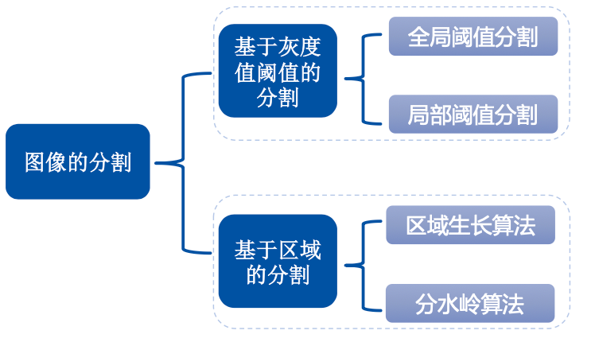

#### 基于灰度阈值

基本思想：基于图像的灰度特征来计算一个或多个灰度阈值，将像素根据比较结果分到合适的类别中。

设置一个灰度阈值T，对于每个像素：\[g(x,y)= \begin{cases} 1,&f(x,y)\geq T\\ 0,&f(x,y)<T \end{cases} \]，1是对象点，0是背景点

> 如何设置合适阈值T？

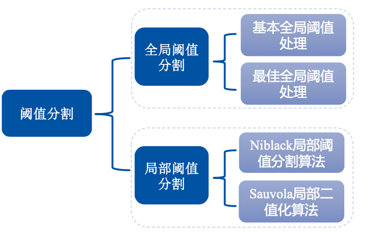

- 基本全局阈值处理：整幅图像使用同一个阈值，适用于背景前景对比大

  - 选择初始阈值$T_0$
  - 根据阈值把像素分为大小两组$G_1,G_2$
  - 分别计算两组像素的平均灰度\[ m_1=\operatorname{mean}(G_1) \]   \[ m_2=\operatorname{mean}(G_2) \]
  - 更新阈值\[ T_{\text{new}}=\frac{m_1+m_2}{2} \]
  - 重复迭代到两次T的差小于设定值（收敛）

- 局部阈值分割：目标与背景所占区域分布不均匀或者两者所占区域大小比例不合理时，图像各个部分像素分布不均匀（在直方图里看，有多个波峰，不好用一个阈值进行二值化），无法使用上述方法。可以不同区域使用不同阈值。

  例如可以用\[ T_{xy}=a\sigma_{xy}+bm_G\]，其中\(\sigma_{xy}\)：像素 \((x,y)\) 邻域内的灰度标准差。\(m_G\)：整幅图像的平均灰度。\(a,b\)：控制阈值的系数。使得阈值随像素变化。

- Niblack局部阈值分割：根据局部区域的灰度特性来确定每个像素的阈值，对于具有不均匀照明或背景噪声的图像尤其有效。但是对于背景噪声较多或背景灰度变化较大的图像可能会产生较差的分割结果，并且计算复杂度较高。

  \[ T(x,y)=\mu(x,y)+k\sigma(x,y)\]，其中\(\mu(x,y)\)：局部区域平均灰度，\(\sigma(x,y)\)：局部区域灰度标准差，$k$控制阈值灵敏度

- Sauvola局部二值化算法：根据局部区域的灰度特性来确定每个像素的阈值，也利用了局部区域的灰度均值和标准差，还有额外参数控制阈值动态范围。优点就是能够自适应地调整阈值范围，因此在不同区域的图像上表现更加稳健。
  $$
  T(x,y)=\mu(x,y) \left[ 1+k\left(\frac{\sigma(x,y)}{R}-1\right) \right]
  $$
  其中\(k\)调节阈值灵敏度，\(R\)控制阈值的动态范围。

#### 基于区域

- 区域生长算法：根据预先定义的规则将像素或者子区域聚合成更大区域的过程。从一组种子点开始，将与该种子点性质相似的相邻像素或者区域与种子点合并，形成新的生长区域，重复此过程直到满足终止条件为止。

  性能很大程度上依赖于种子点的选择和相似性准则的定义

  - 种子点：图像中选择的起始点或初始像素，用来启动区域生长过程
  - 生长规则：像素合并的条件和方式。需要特征相似性度量方法（欧式距离、灰度差异）以及确定像素合并的邻域范围（4/8邻域）
  - 终止条件：停止像素合并。基于相似性度量阈值，以及最大尺寸，图像边界限制
  - 流程：种子点选择——定义生长规则——初始化区域——迭代生长——生长规则判断——更新区域集合

- 分水岭算法（类似于水灌注）：基于图像的灰度或颜色信息，并利用图像中的梯度信息来确定对象的边界，通常用于处理具有复杂纹理和不规则形状的图像。

  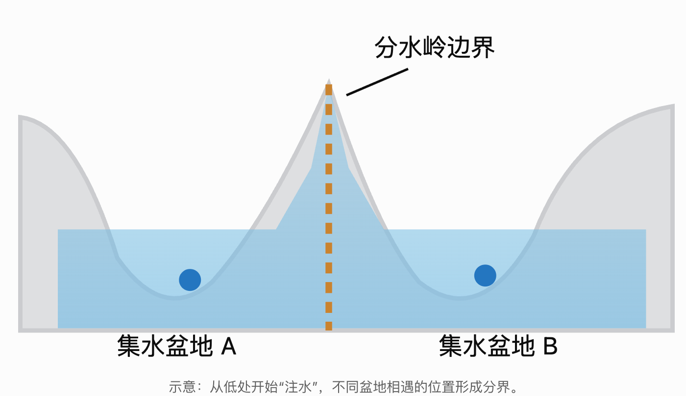

  梯度高的地方被视为潜在的分割边界，而梯度低的地方则表示同一区域内的像素。

  - 流程：梯度计算——种子点标记——标记区域生成（将图像分成多个区域，并分配唯一的标记）——图像灌注构建（利用梯度信息将标记扩展到相邻的像素）——标记区域合并——分割结果生成

- 对比：**区域生长算法**能够显示出具有相同特征的一些像素块，区分度较高，但是算法时间复杂度较高，要确定好初始种子值和不再继续扩张的条件。而**分水岭算法**对于边界非常明显的目标，可以很好的找出目标对象的轮廓

### 图像目标分类

通过分析图像中的主要物体，确定它们所属的类别

#### 目标分类方法

- 聚类算法：K-mean聚类算法，DBSCAN密度聚类算法等，无需标签
- 机器学习：SVM、kNN等，适用于小规模数据和低计算资源的场景，需要标签
- 深度学习：ResNet、AlexNet等，大规模数据和计算资源富余的场景，一般也要标签。

#### 支持向量机（SVM）

**有监督学习**算法，用于分类和回归任务。**基本原理**是构建一个能够将不同类别的数据点有效分隔开的超平面，并且使得该超平面到最近的数据点（支持向量）的距离最大。

- 线性可分：二维空间上两类点被一条直线完全分开叫做线性可分。

- 超平面和间隔：超平面是一个维度比原空间少一维的子空间，二分类问题用超平面把数据分成两部分，超平面与最近数据点的距离就是间隔

- 支持向量：离超平面最近的数据点，对于定义超平面和间隔具有关键作用。决定了最优超平面的位置和方向，最大化间隔的大小和方向。是训练中的关键样本，影响性能和鲁棒性

  

- 数学优化：设训练集为：\[ D=\{(\mathbf{x}_i,y_i)\}_{i=1}^{n} \]，其中$$x$$是样本点特征向量，\[ y_i\in\{-1,+1\} \]是对应类别标签。我们寻找分类超平面：\[ \boldsymbol{\omega}^{T}\mathbf{x}+b=0 \]，做到二分类并使间隔宽度$$\frac{2}{\|\boldsymbol{\omega}\|}$$最大化，可以写成一个优化问题，可通过拉格朗日对偶性和KKT条件求解
  $$
  \begin{aligned} \min_{\boldsymbol{\omega},b}\quad& \frac12\|\boldsymbol{\omega}\|^2\\ \text{s.t.}\quad& y_i(\boldsymbol{\omega}^T\mathbf{x}_i+b)\geq1 ,\quad i=1,\ldots,n \end{aligned} 
  $$
  （硬间隔SVM，最大化间隔，并且要求所有数据点都被正确分类）

  > 似乎课件在公式中写错了写成了max，最大化间隔对应方程应该最小化$\omega$。

  

## 7 深度学习概论1

### 深度学习引言

- 机器学习：对研究问题进行模型假设，利用计算机从训练数据中学习得到模型参数。并最终对数据进行预测和分析的一门学科。其基础主要是归纳和统计。

- 从线性分类器到人工神经元：一个人工神经元可以写为：\[ y=\sigma(w^\top x+b） \]，人工神经网络基本模型与线性分类器的区别在于阈值计算过程是一个可导的非线性激励函数。

  人工神经网络基本模型：神经元接受信号：线性相乘再求和；神经元的响应：非线性激励函数。Sigmoid：\[ \sigma(z)=\frac{1}{1+e^{-z}}\]

- 深度学习是一种实现机器学习的技术, 是机器学习重要的分支。源于人工神经网络的研究，模型结构是一种含多隐层的神经网络。通过组合低层特征形成更加抽象的高层特征。
  - 历史：受人脑神经元工作机理的启发，三起两落
  - Why deep？仿生学。人脑神经系统是深度结构，深度结构能产生复杂认知功能；高维几何学，随着维数增加，空间旋转扭曲，从线性不可分变为可分，模式分类变得容易
  - 以前的阻碍：数据量不足 计算性能不足
  - 三驾马车 Hinton LeCun Bengio
  - 应用领域...

### 数据集

#### 典型数据集

- MNIST 手写数字数据集 适合尝试，预处理方便
- CIFAR-10 彩色图像分类入门数据集，10类，5个训练batch一个test batch，每个1万张
- MS-COCO 更大更复杂，目标检测分割，一个图不止一个object
- ImageNet 李飞飞 基于WordNet层次结构组织的大规模图像数据集

#### 数据标注和数据集划分

- ground truth：真值 （Gold Standard金标准，更常用于医学图像领域 ）

- 有监督学习中数据通常分成训练集、测试集两部分。

  - 训练集(Training Set)用来训练模型，即被用来学习得到系统的参数取值。
  - 测试集(Testing Set)用于最终报告模型的评价结果，因此在训练阶段测试集中的样本应该是未知的。
  - 验证集(Validation Set)：有时对训练集做进一步划分为训练集和验证集。验证集主要用于模型选择和调整超参数，因而一般不用于报告最终结果。

  > 超参数：在学习过程之前需要设置其值的一些变量，而不是通过训练得到的参数数据。如学习率

  - 训练集、测试集的拆分可使用sklearn

- 数据集划分策略

  - **留出法**（Hold-Out Method）：将数据随机分为两组，利用训练集训练分类器，然后利用测试集评估模型，记录最后的分类准确率为此分类器的性能指标。

    处理简单，但是在测试集上的预测性能的高低与数据集拆分情况有很大的关系，性能评价结果不稳定

  - **K折交叉验证**：数据集被分成*K*份（5/10），不重复地每次取其中一份做测试集，用其他*K*‐1份做训练集训练，这样会得到*K*个评价模型，取均值作为最后评价结果。

    有助于提高评估结果的稳定性

  - **分层抽样策略**（Stratified K-fold）：将数据集划分成*K*份，在划分的*K*份中，每一份内各个类别数据的比例和原始数据集中各个类别的比例相同。

### 分类与模型评价

#### 分类问题

分类问题是有监督学习的一个核心问题。分类要解决的是预测样本属于哪个或者哪些预定义的类别。此时输出变量通常取有限个离散值。

- 两大阶段：训练分类器Classifier，利用分类器对新样本做类别预测并进行模型评价
- 两类分类问题和多分类问题（可看成one-vs-rest的两类分类问题）

#### 分类问题的模型评价

假设只有正类P和负类N

**分类性能度量：**

- 混淆矩阵：

  | 实际类别 \ 预测类别 | 正类 P | 负类 N |
  | :-----------------: | :----: | :----: |
  |     实际正类 P      |   TP   |   FN   |
  |     实际负类 N      |   FP   |   TN   |

> TF表示预测对错，PN表示**预测**的类别。例如 FP 是模型预测为正，但实际为负

- **准确率** Accuracy：\[ \text{Accuracy}=\frac{TP+TN}{TP+TN+FP+FN}\]  预测正确的样本数 / 全部样本数

  正负样本数不均衡时，仅用准确率进行评价具有局限性。因此**精确率** (precision) 和**召回率** (recall) 是二分类问题常用的评价指标

- **精确率** Precision：\[ \text{Precision}=\frac{TP}{TP+FP} \]  模型找出来的正类，有多少是真的？（误报）

- **召回率** Recall：\[ \text{Recall} =\frac{TP}{P} =\frac{TP}{TP+FN}\]   真正的正类有多少被模型找出来了？（漏报）

- **P-R 曲线**：横坐标为召回率，纵坐标为精确率，是一对矛盾。**越靠近右上越好**。

- **Area Under Curve** ( AUC )：P-R 曲线下的面积 $$\int_0^1p(r)\,dr$$，有助于弥补P、R的单点值局限性，可以反映全局性能。理想的类别P-R 曲线其AUC=1

- 如何绘制P-R曲线？

  > 一个分类器不是只有一个 Precision 值和一个 Recall 值吗？为什么能画出一整条曲线？—— 改变分类阈值

  对于每个测试样本，分类器输出的是Score值，表示该样本多大概率属于正例。从高到低将Score值排序并依次作为阈值threshold，对于每个阈值，Score值大于或等于这个threshold的测试样本被认为正例，其它为负例。从而形成一组预测数据，然后计算并画图

- **F值**：$$F_\beta - score$$是精确率和召回率的调和平均：
  $$
  F_\beta=\frac{(1+\beta^2)PR}{\beta^2P+R}
  $$
  $$\beta$$ 一般大于0，大于1表示更重视R。 $$F_1$$常用，表示二者同等重要。\[ F_1=\frac{2PR}{P+R} \]

- ROC（受试者工作特征曲线）：
  - TPR：真正例率  \[ TPR=\frac{TP}{TP+FN}=RECALL\] 命中概率
  - FPR：假正例率  \[ FPR=\frac{FP}{FP+TN}=\frac{FP}{N} \]，假阳性率，负类有多少被误判成了正类
  - 纵轴tpr，横轴fpr的曲线（绘制时和AUC一样，仍然是改变阈值形成一组数据）**越靠近左上越好**
  - ROC-AUC：ROC曲线下的面积，越大越好，理想下为1

**分类性能可视化：**混淆矩阵的可视化，可以用**热图**(Heatmap)直观展现（每个类有多少样本被错误地预测成另一个类）

**分类报告：**就是做成表格，显示每个类的分类性能 e.g.每个类标签的精确率、召回率、F1值等

### 典型网络结构

#### 卷积神经网络

##### 为什么需要CNN

- 全部使用全连接：存储量、计算量巨大，维度灾难
- 动物视觉对外界感知：感受野(皮层神经元只响应局部刺激)、分层处理，底层局部顶层全局——多层深度网络传导、局部连接
- 人类人脸识别同理，每个神经元感知局部，在更高层综合

##### 概述

- 概念：卷积神经网络（Convolutional Neural Networks, CNN）是一类包含卷积计算且具有深度结构的前馈神经网络，是深度学习中的代表网络结构之一。
- 仿造生物的视知觉机制构建 LeNet-5是较早的卷积神经网络
- 特点：局部卷积、参数共享、多卷积核、池化操作、多层处理、误差的深度反传

##### 局部卷积

- 图像卷积：模拟生物视觉感受野的局部信息处理过程。卷积是作用于矩阵的一个滑动窗口函数。滑动窗口又称作卷积核、滤波器或是特征检测器。输出特征图中每个像素实际上是输入图像中局部区域中像素的加权平均，其权值由卷积核定义
- 卷积计算公式：卷积核与图像局部区域矩阵相乘
- 局部卷积的优势：大量减少参数，每个神经元只连接图像中的一部分区域
- 计算例子：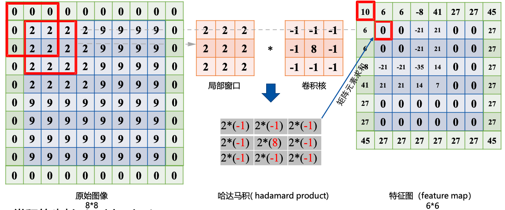
- 卷积步长：窗口每次移动格数；宽卷积（边界填0，绿色）与窄卷积（不处理）

- 输出窄卷积尺寸：$H_{out}=\lfloor \frac{H_{in}-k_h}{s_h}\rfloor+1$，以高度为例，k是卷积核的高，s是步长高

##### 参数共享

同一个卷积核在整张图像上滑动，所有局部都使用权重相同的卷积核（卷积提取特征的方式，该方式与位置无关），可以大量减少参数量

卷积核如何确定、权重如何确定：人为设计/在线训练

##### 多卷积核（参数不同或尺寸不同）

不同卷积核生成的不同图像可以理解为是该输入图像的不同**特征提取**通道，在同一层中使用多个卷积核，得到多个特征图。

##### 池化Pooling （降采样subsampling）

- 原因：图像的统计特性具有空间不变性，为描述大的图像，可以对不同位置的特征进行聚合统计。卷积层虽然可以显著减少连接的个数，但是每一个特征映射的神经元个数并没有显著减少。输入分类器的特征维数依然很高， 很容易出现过拟合。

- 概念：采用图像区域上某个特征的**平均值 (或最大值**)来表达该区域，适当降低维度，防止过拟合
- 优点：降维、克服过拟合、在图像识别领域能提供平移和旋转不变性

##### 多层处理

一层卷积及池化往往只学到了局部的特征。层数越多，学到的特征越全局化。因此通过这样的多层处理，低级的特征组合形成更高级的特征表示。（变深，维度变小，感受野变大）

特征图（Feature Map）：卷积核作用于输入后得到的响应结果、特征映射。

##### 误差深度反传

卷积神经网络的**激活函数**与**输出函数**保证了误差反向传递的可行性

- 激活函数：用在中间层，保证可微性、非线性、单调性等特点。合适的激活函数防止反传梯度消失
- 输出函数：用在最后输出，例如softmax。保证深度学习模型更好地收敛。

##### 完整目标分类过程

输入——卷积——池化——卷积——池化——全连接——softmax分类

##### LeNet-5的详细例子

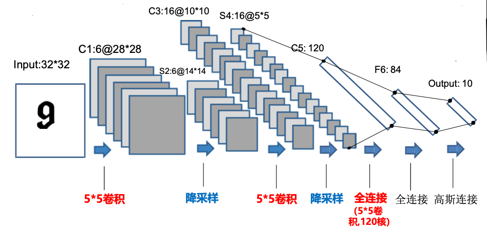

- 输入尺寸 32*32；3个卷积层；2个池化层；输出是手写数字0-9的识别概率
- C1：6个5*5的卷积核，输出28\*28\*6（维度），参数(5\*5+1bias)\*6=156，连接数156\*28\*28=122,304
- S2：滑动窗口2\*2，步长2，S2的size变成C1的1/4，通道数不变
- C3：每个特征图只与上一层S2中**部分**特征图相连接，每个卷积核大小是5\*5，但是连接的输入特征图数量有区别，所以维度数不同。
- S4：与S2一样。S4层的size是C3层的1/4
- C5：有120个核，每一个大小5*5，与S4所有特征图相连（16维），因此形成一个120维的特征向量。参数 120\*(5\*5\*16+1bias)=48120
- F6：全连接，84个神经元，参数120\*84+84=10,164  点积、偏置、sigmoid
- 输出层：这里用的欧式径向函数而不是softmax。\[ y_i=\|x-w_i\|_2^2 \]  判断输出向量和10个数字的参考向量有多接近。

#### 递归神经网络 RNN

- CNN的局限：CNN是前馈网络（输入与输入之间完全没有关系，因此只能单独处理独立的**单次输入**），网络每层之间节点无连接适用静态数据， 如图像等。不适合于视觉这种有**时序**的图像信号。

- RNN的应用场景：语音识别、机器翻译、字符串识别、视频分析 （Recurrent递归）

- 概念：反馈网络，模拟“人脑记忆功能”，对序列动态数据进行智能处理。使用带自反馈的神经元，能处理任意长度序列。序列当前输出与当前输入和之前输出都有关。

- 数学模型：简单递归网络，由输入层、一个隐藏层和一个输出层组成。

  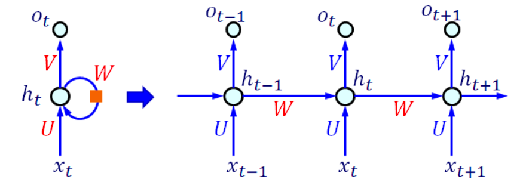
  $$
  h_t=f(Ux_t+Wh_{t-1}+b)\quad \text{隐藏状态计算} \\
  o_t=f(Vh_t+b') \quad \text{输出计算}
  $$
  $$U$$是输入到隐藏层的权重矩阵，$$W$$是隐藏状态之间的循环权重矩阵，$$V$$是隐藏层到输出层到权重矩阵，$$b$$是偏置，$$f$$是非线性激活函数。

  \[ U,V,W \]在不同时间步全局共享，可用BP反向传播算法针对特定任务进行学习优化。

- 特点：当前输出与当前输入以及之前输出（记忆）有关；隐藏层之间的节点不再无连接而是有连接的（可以在隐层之间反馈）；隐藏层的输入包括输入层以及上一时刻隐藏层的输出

- 递归关系： 可通过上一时刻隐藏状态，递推计算整个序列。\[ h_T=f(Ux_T+Wh_{T-1}+b) \]

- 训练：Back Propagation Through Time (BPTT) 时间反向传播算法

  假设网络在每个时刻 \(t\) 都有监督信息，当前时刻的损失记为：\[ J_t \]，那么一个长度为 \(T\) 的序列，总损失为：\[ J=\sum_{t=1}^{T}J_t \]。对 \(W\) 求导有：
  $$
  \frac{\partial J}{\partial W}=\sum_{t=1}^{T}\frac{\partial J_t}{\partial W}
  $$
  反向传播时，梯度沿计算图从后面的时刻传播回前面的时刻。BPTT 本质上仍然是链式法则和反向传播，只是需要先将循环结构沿时间展开。

  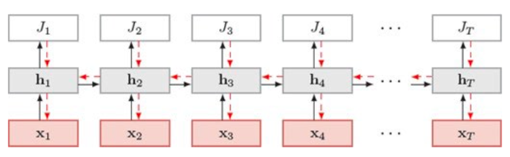

- 训练的问题——梯度消失与爆炸：目标函数可能具有多个极小值、平坦区域，以及非常陡峭的区域。在长序列训练中，梯度会沿时间链反复传播。可能出现

  - 梯度消失：Jacobian 矩阵奇异值小于 1
  - 梯度爆炸：Jacobian 矩阵奇异值大于 1
  - 难以学习长期依赖，只能学到短周期依赖关系——>建立门机制，控制信息的累积，选择性遗忘之前的信息

#### 长短期记忆网络 Long Short-Term Memory neural network

LSTM通过引入三个门，做到有选择性的记忆或者遗忘

\(c_t\)：Cell State，细胞状态，承担跨时间保存信息的重要作用。\(h_t\)：Hidden State，隐藏状态，表示当前时刻向外传递的状态。\(f_t\)：Forget Gate，遗忘门，\(i_t\)：Input Gate，输入门，\(o_t\)：Output Gate，输出门。\(\odot\) 表示逐元素乘法。

- 三个门：

\[ o_t=\sigma(W_ox_t+U_oh_{t-1}+b_o) \]   

\[ i_t=\sigma(W_ix_t+U_ih_{t-1}+b_i) \]  

\[ f_t=\sigma(W_fx_t+U_fh_{t-1}+b_f) \]

- 候选记忆与状态更新：

\[ \tilde c_t=\tanh(W_cx_t+U_ch_{t-1}+b_c) \]

\[ c_t=i_t\odot\tilde c_t+f_t\odot c_{t-1} \]

\[ h_t=o_t\odot\tanh(c_t) \]

- 遗忘门的值来决定历史信息是否重要，如否则关闭

- 输入门决定输入信息是否有意义，如否则关闭（\(\tilde c_t\) 称为候选细胞状态，它根据当前输入和上一时刻隐藏状态，产生一个候选的新记忆内容。然后再由输入门决定写入多少）
- 输出门决定此时是否要回应，如否则关闭

> 补：为什么解决了梯度消失/爆炸的问题：
>
> 普通 RNN：\[ h_t=\tanh(Ux_t+Wh_{t-1}+b) \]，信息沿时间传播时，梯度会反复经过权重矩阵和激活函数导数。如果相关 Jacobian 反复产生收缩，梯度就可能越来越小。
>
> 而 LSTM：\[ c_t=f_t\odot c_{t-1}+i_t\odot\tilde c_t \]，具有一条加法记忆路径。当我们只看细胞状态更新中从 \(c_{t-1}\) 直接传向 \(c_t\) 的分支时，其局部导数为：
>
> \[ \frac{\partial c_t}{\partial c_{t-1}}\bigg|_{\text{直接路径}} =\operatorname{diag}(f_t) \]
>
> 如果遗忘门的相关分量接近 1：\[ f_t\approx1 \]那么沿这条直接路径传播的信息和梯度就不容易迅速衰减。因此网络可以通过学习门控参数，自适应地控制哪些信息需要在较长时间内保存。

- LSTM可以根据任务需求，灵活设定网络结构
  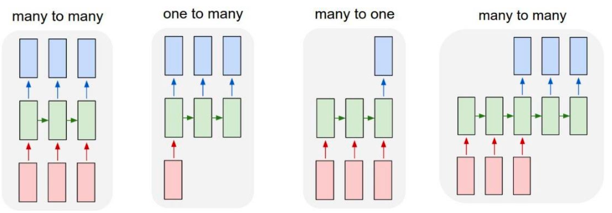

- 例子：用LSTM+CTC作为分类器识别银行卡号

#### 生成对抗网络 Generative Adversarial Networks

- 生成网络：合成 创造数据
- 判别网络：判别生成的数据是否真实
- 同时训练，直到判别网络不能鉴别生成数据真假
- 应用：图像修复、零件缺陷检测

#### 注意力机制

- 原因：

  - 在向量序列问题处理时，RNN的运算很难并行化，CNN（小卷积核）无法直接获取全局信息
  - Self-Attention可以并行运算并输出，同时每一个输出变量$$b^i$$都考虑了整个序列的信息

- 自注意力的计算：查询**-**键**-**值（QKV）模式

  假设有四个输入：\[ x^1,x^2,x^3,x^4 \]，先做一次特征转换：\[ a^i=Wx^i \]然后对每个 \(a^i\)，分别生成三个向量：\[q^i=W^qa^i\]，\[ k^i=W^ka^i \]，\[ v^i=W^va^i \]。其中 \(W^q,W^k,W^v\) 是可学习的投影矩阵。

  对于查询的输入，用自己的q与所有k做点积，结果缩放除以$\sqrt{d}$后做softmax，在点积对应的value向量即可得到输出。

  用矩阵并行实现：
  $$
  \operatorname{Attention}(Q,K,V)
  =
  \operatorname{softmax}\left(
  \frac{QK^\top}{\sqrt{d_k}}
  \right)V
  $$

- 多头自注意力：在使用自注意力计算相关性的时候，就是用q去找相关的k。但是相关有很多种不同的形式，所以也许可以有多个q，不同的q负责不同种类的相关性，这就是多头注意力。和多卷积核本质上一样
- 自注意力网络和CNN的关系
  - 自注意力在做内积的时候，考虑的不是一个小的范围，而是整张图像的信息
  - 卷积神经网络会“画”出一个感受野，每一个滤波器，每一个神经元，只考虑感受野范围里面的信息
  - 卷积神经网络可以看作是一种简化版的自注意力，是受限制的自注意力。
  - 自注意力是更灵活的卷积神经网络，只要通过某些限制，自注意力网络就会变成卷积神经网络。

### 小结

#### 当前不足

- 学习能力：需要**大量** **标记样本**进行**监督**学习
- 解释能力：通过分层结构，一定程度上解释分类过程，但是结构分析、可解释性不足
- 鲁棒性：对噪声模式的拒识能力；对对抗样本的稳定性
- 综合信息处理能力：多模态协同能力不足；上下文、语义知识表达处理不足（目前的LLM已经得到显著改善）

#### 未来研究方向

**认知计算模型：**

- 模式识别、学习、记忆的认知机理
- 认知计算模型
- 类脑仿生计算模型

**模型表示：**

- 模型结构：适合鲁棒在线自适应的需要，可解释性。（传统方法+深度学习）
- 更好的生成模型：扩散模型（Diffusion Model）。
- 结构和知识的表示与学习？
- 有没有更好的网络模型结构？（Transformer结构、Mamba状态空间模型、TTT架构等）

**学习方法：**

- 无监督学习
- 有监督/无监督混合自适应学习
- 对抗学习
  - 通过对抗提高小样本泛化性（例如：缺陷检测）
  - 对抗、反对抗 
- 迁移学习：多任务、多模态协同学习
- 参数高效微调：针对大模型，使用LORA、Adapter等技术微调部分参数。

## 8 深度学习概论2

### 神经网络的训练

- 训练的内容：参数（连接权值、偏置量）；超参数（学习率、迭代次数、层数、卷积核数量、大小等）不是普通反向传播自动学到的，而是由我们事先指定，或者通过其他调参方法确定
- 训练的本质：数据拟合。选择适当的曲线类型来拟合观测数据，并用拟合的曲线方程分析变量间的关系。是一种把现有数据透过数学方法来描述的表示方式。

#### 拟合

- 过程：科学和工程问题可以通过诸如采样、仿真、实验等方法获得若干离散的数据，根据这些数据，希望得到一个连续的函数（曲线或曲面）或者更加密集的离散方程与已知数据预测相吻合，这过程就叫做拟合(fitting)。
- **万能近似定理**数学上证明了前馈神经网络，只需具备单层隐层和有限个神经单元，就能以任意精度拟合**任意复杂度的连续函数**（训练非常困难）
- 拟合的本质——归纳，从科学方法论来看，归纳的基本要求是足够大、且覆盖全部时间空间维度的样本+科学的统计分析。现在主流的深度学习算法，是用计算机对超大量数据进行复杂归纳，推理过程是概率预测过程
- 欠拟合：学得太少，分得太粗糙；（数据量不够，或者训练不充分）
- 过拟合：学得太多太细

#### 训练

- 多层神经网络训练的三大基本步骤：正向计算、误差计算、反向权重修正

- 正向计算：计算隐层节点的输出，计算输出层节点的输出

- 修改隐藏层到输出层之间的权重 \(w_{jk}\)？：损失函数以平方误差为例，\[ E=\frac12\sum_{k=1}^{n}(y_k-t_k)^2 \]，其中 \(y_k\) 是预测输出，\(t_k\) 是真实目标。对于：
  $$
  \frac{\partial E}{\partial w_{jk}}
  $$
  根据链式法则\[ w_{jk}\longrightarrow b_k\longrightarrow y_k\longrightarrow E \]有
  $$
  \frac{\partial E}{\partial w_{jk}}
  =
  \frac{\partial E}{\partial y_k}
  \frac{\partial y_k}{\partial b_k}
  \frac{\partial b_k}{\partial w_{jk}}
  =
  
  (y_k-t_k)\times y_k(1-y_k) \times z_j
  
  \\
  
  w_{jk}^{\mathrm{new}}
  =
  w_{jk}^{\mathrm{old}}
  -\eta\frac{\partial E}{\partial w_{jk}}
  $$
  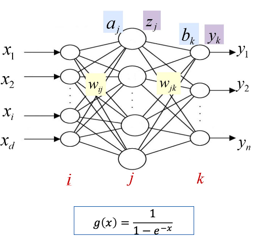
  
- 同理更新输入层到隐藏层之间权重 \(w_{ij}\)，路径是\[ w_{ij}\to a_j\to z_j\to b_k\to y_k\to E \]。
  $$
  \begin{align*}
  \frac{\partial E}{\partial w_{ij}}
  &=
  \sum_{k=1}^{n}
  \frac{\partial E}{\partial y_k}
  \frac{\partial y_k}{\partial b_k}
  \frac{\partial b_k}{\partial z_j}
  \frac{\partial z_j}{\partial a_j}
  \frac{\partial a_j}{\partial w_{ij}}
  
  
  \\
  &=
  \sum_{k=1}^{n}
  (y_k-t_k)y_k(1-y_k)
  \times w_{jk} \times z_j(1-z_j) \times x_i
  \end{align*}
  $$

  > 出现求和：因为隐藏层的一个神经元可能连接到多个输出节点，而它对损失的影响需要累加所有相关输出路径的贡献

### 激活函数

- 激活函数加入非线性因素，解决线性模型所不能解决的问题。激活函数的意义是“让神经网络具备强大的拟合能力”。如果没有非线性激活函数，神经网络只是一个线性回归模型。

- 常用：Sigmoid函数、tanh函数、ReLU函数、Softmax函数
- 特征：
  - 非线性：非线性映射和函数逼近能力
  - 可微性：误差反向传播时要求导
  - 单调性：保证网络训练方向的一致性，有利于学习曲线的收敛
  - 计算简单
  - 归一化：平衡不同的通道、不同批次的数据之间的尺度、范围，量纲的不同等
  - 输出有界，便于实现输出限制条件
  - $$f(x) \approx x$$，保持与原信息相似度

#### Sigmoid

$$
\sigma(x)=\frac{1}{1+e^{-x}}  \qquad 
\sigma'(x)=\frac{e^{-x}}{(1+e^{-x})^2}
$$

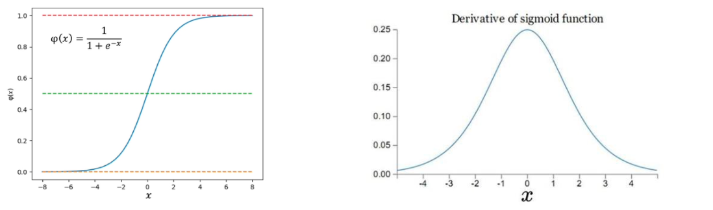

- 优点：输出范围有界 (0,1)，数据在传递的过程中不容易发散，可以在输出层表示概率值。导数非零，容易计算
- 缺点：梯度下降非常明显，两头过于平坦，容易梯度消失，输出值域不对称

#### 双曲正切 tanh

$$
\tanh(x)=\frac{e^x-e^{-x}}{e^x+e^{-x}} \qquad 
\tanh'(x)=1-\tanh^2(x)
\\\\

(\tanh(x)=2\sigma(2x)-1 )
$$

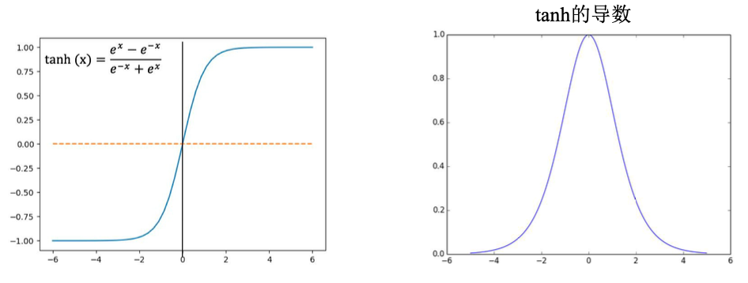

- 优点：值域(-1,1)，解决了Sigmoid函数输出值域不对称问题，完全可微分和反对称，对称中心在原点。
- 缺点：输出值域两头依旧过于平坦，梯度消失问题仍然存
- 为了解决学习缓慢和梯度消失问题，演化出一些平缓的变体，如log-log、Softsign、Symmetrical Sigmoid等

#### ReLU

$$
\operatorname{ReLU}(x)=\max(0,x) \qquad 

f'(x)=
\begin{cases}
0,&x<0\\
1,&x>0
\end{cases}
$$

- 深度学习中常用的激活函数

- 优点：线性特点，收敛更快，没有梯度饱和的情况，计算更高效，只需要一个阈值就可以得到激活值，不需要对输入归一化来防止达到饱和

- 缺点：死亡神经元问题：如果一个神经元预激活值始终\[ wx+b<0 \]，那么此时误差无法通过该 ReLU 分支有效回传，相关参数可能无法继续从这条路径获得更新。如果某个神经元对训练集中的所有输入长期如此，它就可能成为“死亡神经元”。

- 解决办法：Leaky ReLU：带泄漏修正线性神经元。（$$\alpha$$是一个很小正数）
  $$
  f(x)=
  \begin{cases}
  \alpha x,&x<0\\
  x,&x\ge0
  \end{cases}
  \qquad
  
  f'(x)=
  \begin{cases}
  \alpha,&x<0\\
  1,&x>0
  \end{cases}
  $$

#### Softmax

Softmax是对一个向量进行运算，并将各分量映射为总和等于 1 的类别概率分布

假设网络的输出是：\[ z=[z_1,z_2,\ldots,z_C] \],其中 \(C\) 为类别数量。Softmax 定义为：
$$
p_i=\frac{e^{z_i}}{\sum_{j=1}^{C}e^{z_j}}
$$
（先指数映射再归一化）

- 归一化：解决奇异样本数据问题，奇异样本数据指的是相对于其他输入样本特别大或特别小的样本矢量。（例如过曝图像）

  > 归一化的其他方法：
  >
  > **最大最小标准化**：对原始数据进行线性变换\[ x'=\frac{x-x_{\min}}{x_{\max}-x_{\min}} \]，标准化后的值落在 \([0,1]\)
  >
  > **Z-score标准化：**基于原始数据的均值和标准差进行的数据标准化，适用于属性A的最大值或者最小值未知的情况，或有超出取值范围的离散数据的情况。\[ x'=\frac{x-\mu}{\sigma} \]。（并不把数据限制在 \([-1,1]\) 或 \([0,1]\) 内，只是调整为均值约 0，标准差约 1）

- 优点：可以使分类问题的预测结果更加明显，不同类别之间的差距更大。
- 推荐采用交叉熵与 Softmax（激活函数）结合作为损失函数，可以避免数值不稳定的情况。

#### 选择激活函数

- 卷积网络通常使用ReLU函数，并注意设置好学习率
- 如果存在死亡神经元的问题，就尝试Leaky ReLU函数
- 尽量避免使用Sigmoid函数
- tanh函数大部分情况下效果不如ReLU函数

### 损失函数

对反向传播\[ \frac{\partial E}{\partial w} = \frac{\partial E}{\partial y} \frac{\partial y}{\partial w} \]，激活函数关注\(\frac{\partial y}{\partial w}\)，而另一部分便是损失函数

- 损失函数评价的是模型对样本的拟合度
  - 预测结果与实际值越接近，网络的拟合能力越强，损失函数越小；反之
  - 损失函数较大时，对应的梯度下降一般会比较快
- 损失函数的度量：最小化实际值与估计值之间的偏差，例如\[ L=\sum_{i=1}^{N}(\hat y_i-y_i)^2 \]。
- 设计准则：
  - 可求导，要BP
  - 计算简单
  - 保证好的收敛，损失函数大小要能够很好体现预测与目标之间的差距
- 常见损失函数：
  - 图像分类：交叉熵
  - 目标检测：Focal loss，L1/L2损失函数，IOU Loss，GIOU ，DIOU，CIOU
  - 行人重识别、人脸识别：Triplet Loss，Center Loss，Sphereface，Cosface，Arcface

#### 目标分类的损失函数——交叉熵 CrossEntropy

在图像分类中，经常使用Softmax（激活函数）+交叉熵作为损失函数
$$
\text{损失函数}L=H(p,q)=-\sum_{i=1}^{C}p_i\ln q_i
$$
其中 \(p_i\)：真实概率分布。\(q_i\)：模型预测概率分布。两者越接近，熵值越小。交叉熵损失函数通过缩小两个概率分布的差异，来使预测概率分布尽可能达到真实概率分布。

> 补：用softmax做输出然后经过交叉熵损失，设 Softmax 输出：\[ q_i=\frac{e^{z_i}}{\sum_j e^{z_j}} \]，交叉熵：\[ L=-\sum_i y_i\ln q_i \]。
>
> 可以推导：\[ \frac{\partial L}{\partial z_i}=q_i-y_i \]，非常简洁，它意味着，对于 Softmax 前面的 Logits，交叉熵梯度就是预测概率减去真实标签

#### 目标检测的损失函数

两部分组成：**分类损失**（classification loss）：类别分类尽可能正确 + **检测框回归损失**（bounding box regression loss）：预测框尽可能与GT框匹对上 （是什么 在哪里）

##### 分类损失——Focal loss

- 交叉熵的问题：正负样本之间不平衡，模型可能没有充分关注那些真正困难的样本

- 解决：降低简单样本中的损失值，间接提高了困难样本中损失值的权重。
  $$
  FL(p_t)=-\alpha_t(1-p_t)^\gamma\log(p_t)
  $$
  其中 \(p_t\)：模型分配给真实类别的概率。 \(\alpha_t\)：类别权重，用来调节类别不平衡。\(\gamma\)：聚焦参数（Focusing Parameter），控制简单样本损失被削弱的程度。

  在交叉熵前面增加了 \[(1-p_t)^\gamma \]，对于困难样本，$$p_t$$很小，处理后差别不大；但是对于简单样本$$p_t$$很大，相乘后损失被削弱。当$$\gamma=0$$时公式退化成交叉熵。

##### 检测框回归损失

**L1，L2，smooth L1损失函数**

假设预测框与真实框的一个坐标误差为：\[ x=\hat t-t \]，我们希望 \(x\) 越接近 0 越好。
$$
L_1(x)=|x| \qquad 
L_1'(x)=
\begin{cases}
-1,&x<0\\
1,&x>0
\end{cases}

\\\\

L_2(x)=x^2
\qquad 

L_2'(x)=2x

\\\\

L_{\mathrm{smoothL1}}(x)=
\begin{cases}
\frac12x^2,&|x|<1\\
|x|-\frac12,&|x|\ge1
\end{cases}

\qquad 

L_{\mathrm{smoothL1}}'(x)=
\begin{cases}
x,&|x|<1\\
\operatorname{sign}(x),&|x|\ge1
\end{cases}
$$

- *L*1损失函数对*x*的导数为常数，在训练后期，*x*很小时，如果learning rate 不变，损失函数会在稳定值附近波动，很难收敛到更高的精度。（训练末期不稳定）
- *L*2损失函数对*x*的导数在*x*值很大时，其导数也非常大。（训练初期不稳定）
- smooth *L*1完美的避开了*L*1和*L*2损失的缺点。
- 但是上面的三种Loss用于计算目标检测的Bounding Box Loss时，独立的求出目标框4个点的Loss，然后进行相加得到最终的Bounding Box Loss，这种做法的假设是4个点是相互独立的，实际是有一定相关性的。所以还可以改进：

**IOU损失函数（物理意义更加明确）**
$$
\operatorname{IoU}(A,B)
=
\frac{|A\cap B|}{|A\cup B|}
$$
其中：两个检测框：预测框 \(A\)，真实框 \(B\)，分子分母分别是交集和并集的面积，值域在[0,1]。具有相同的欧氏距离的框，其IOU值却不是唯一的，IOU越大检测位置越准确

- 损失函数的形式：

$$
L_{\mathrm{IoU}}=1-\operatorname{IoU} \quad or \quad L_{\mathrm{IoU}}=-\ln(\operatorname{IoU})
$$

- 问题：当两个框完全不相交时，IoU = 0，普通 IoU Loss 通常无法提供有效的移动方向梯度。
- 变种：GIOU（引入包围两个框的最小外接矩形，考虑未覆盖区域）、DIOU（进一步考虑预测框与真实框的中心距离）、CIOU（同时考虑 IoU、中心距离和宽高比一致性）

### 学习率

- 梯度下降：是基于函数一阶性质的优化算法，一直朝下坡最陡的方向运动，目标是找到函数的全局最小点。人工神经网络的训练主要采用梯度下降法。其计算过程中采用误差反向传播的方式计算误差函数对全部权值W和偏置值b的梯度。而梯度指明寻优的方向，步长便是学习率

- 常见学习率设置方法：

  - 固定
  - 基于经验手动调整
  - 均分分布降低策略
  - 指数级衰减
  - 多项式策略
  - 动量法动态调整
  - 随机梯度下降 ...

- 学习中的问题1：梯度消失与爆炸

  - 重新设计网络模型
  - 使用ReLU
  - 使用梯度截断
  - 使用权重正则化

- 问题2：局部极小值

  - 从不同初始权值开始训练
  - 使用SGD随机梯度下降代替真正梯度下降
  - 设置冲量（其实就是动量法）

- 问题3：过拟合——**采用Dropout**

  - 每次训练都随机让一定神经元停止参与运算，简单的操作让我们由一个模型演变成多个模型。使得模型稳定性和鲁棒性被大大提高了

    *为什么能解决？*

  - a. 取平均的作用：整个dropout过程就相当于对很多个不同的神经网络取平均。而不同的网络产生不同的过拟合，一些互为“反向”的过拟合相互抵消就可以达到整体上减少过拟合。

  - b. 减少神经元之间复杂的共适应关系：两个神经元不一定每次都在一个dropout网络中出现。这样权值的更新不再依赖于有固定关系的隐含节点的共同作用，阻止了某些特征仅仅在其它特定特征下才有效果的情况 ，迫使网络去学习更加鲁棒的特征。

  - c. 类似于性别在生物进化中的角色：性别的出现可以繁衍出适应新环境的变种，有效的阻止过拟合，即避免环境改变时物种可能面临的灭绝

- 问题4：样本分布不均衡——**批标准化 batch normalization**

  - 问题：若训练过程中每批的数据分布各不相同，那么网络每次迭代的学习过程就会出现较大波动，使之更难趋于收敛。对于深层网络，网络前几层的微小变化都会被网络累积放大，则训练数据分布变化问题就会被放大，更加影响训练速度。

  - 具体计算：\[ \boxed{ \text{计算统计量} \rightarrow \text{标准化} \rightarrow \text{可学习缩放和平移} } \]

    

  - 效果：改变一个 Batch 上某层某神经元加权和的值的分布

### 卷积网络的训练

- 如何训练：BP前馈神经网络的训练机制

  - 前向传播——损失函数——反向传播——更新权重
  - 开始训练之前，权重值也是随机初始化的，卷积核不知道提取哪些特征值，给图片打标签，就是CNN有监督训练的过程
  - 传统的神经网络是全连接形式的，如果进行反向传播，只需要由下一层对前一层不断的求偏导，即求链式偏导就可以求出每一层的误差敏感项，然后求出权重和偏置项的梯度，即可更新权重。
  - 对于CNN上特殊的卷积和池化层：池化层输出时是取一个滑动窗口的最大值，它的偏导是1，回传的时候这个1传回前向来的时候取的那个最大值位置。卷积层由于有权重共享，回传要更新卷积核参数（累加）

- CNN卷积层反向传播的例子：

   输入矩阵：5×5 \[ A= \begin{bmatrix} a_1&a_2&a_3&a_4&a_5\\ a_6&a_7&a_8&a_9&a_{10}\\ a_{11}&a_{12}&a_{13}&a_{14}&a_{15}\\ a_{16}&a_{17}&a_{18}&a_{19}&a_{20}\\ a_{21}&a_{22}&a_{23}&a_{24}&a_{25} \end{bmatrix} \]，

  卷积核：3*3 \[ W= \begin{bmatrix} w_1&w_2&w_3\\ w_4&w_5&w_6\\ w_7&w_8&w_9 \end{bmatrix} \]    步长为2，因此输出矩阵：2×2  \[ Z= \begin{bmatrix} z_1&z_2\\ z_3&z_4 \end{bmatrix} \]

  

  \[ \begin{aligned} z_4={}&w_1a_{13}+w_2a_{14}+w_3a_{15}+w_4a_{18}+w_5a_{19}+w_6a_{20}+w_7a_{23}+w_8a_{24}+w_9a_{25} \end{aligned} \] 

  我们需要计算：\[ \frac{\partial L}{\partial w_1}, \frac{\partial L}{\partial w_2}, \ldots, \frac{\partial L}{\partial w_9} \]，然后组成梯度矩阵：\[ \nabla_W L \]，最后按照梯度下降更新：\[ W_{\mathrm{new}}=W_{\mathrm{old}}-\alpha\nabla_W L \]。接下来我们推导$$W_1$$的梯度作为例子：
  

  \[  \begin{aligned} \frac{\partial L}{\partial w_1} ={}& \frac{\partial L}{\partial z_1} \frac{\partial z_1}{\partial w_1}+ \frac{\partial L}{\partial z_2} \frac{\partial z_2}{\partial w_1}+ \frac{\partial L}{\partial z_3} \frac{\partial z_3}{\partial w_1}+ \frac{\partial L}{\partial z_4} \frac{\partial z_4}{\partial w_1} \end{aligned}  \]，$$w_1$$与$$z_{1-4}$$均有连接，代入卷积的公式
  $$
  \frac{\partial L}{\partial w_1}
  =
  a_1\frac{\partial L}{\partial z_1}
  +a_3\frac{\partial L}{\partial z_2}
  +a_{11}\frac{\partial L}{\partial z_3}
  +a_{13}\frac{\partial L}{\partial z_4}
  $$
  一个卷积核权重的梯度，等于它在不同滑动位置对应的输入值与输出梯度相乘后，再累加，其他位置同理。

- 训练方法：

  - 单样本训练（随机梯度下降SGD）：每输入一个样本，都要回传误差并调整权值，这种对每个样本轮训的方法称为单样本训练。单样本训练只针对每个样本产生的误差进行调整，难免顾此失彼，使训练次数增加，导致收敛速度变慢。内存占用少，振荡、有遗忘问题。

  - 批量训练（批量梯度下降BGD）：在所有样本输入后计算网络的总误差，再根据总误差调整权值，这种累积误差的批量处理方式称为 “批训练”或“周期训练”。易于并行训练，但是样本量大的时候内存占用多，训练速度变慢。

  - 小批量训练（Mini-batch）：“小批量梯度下降训练法”是单样本和批量训练的折中办法，每次用小批量样本进行更新学习。

  - 单样本 SGD 的轨迹更曲折，而批量梯度下降的轨迹相对平滑（噪声差异）

    

- 三个定义
  - Epoch：使用训练集的全部数据对模型进行一次完整训练，被称之为“一代训练”
  - Batch：一次参数更新所使用的一组训练样本，“一批数据”
  - Iteration：使用一个Batch数据对模型进行一次参数更新的过程，被称之为“一次训练”

## 9 深度学习概论3——分类、检测与分割网络

目标识别任务大致可以分为：图像分类、目标检测、目标分割与实例分割

### 目标分类网络

#### LeNet-5 

手写数字识别，该网络还不能叫深度网络，中间层激活函数是**tanh**，输出层激活函数是**softmax**，结构在第七章分析过了。卷积-池化-卷积-池化-卷积-全连接-输出层

#### AlexNet

- 2012年Imagenet竞赛的冠军模型，证明了CNN在复杂模型下的有效性，使用GPU使得训练在可接受的时间范围内得到结果，推动了有监督深度学习的发展

- 5个卷积+3个全连接层

| 层   | 输入尺寸  | 核数量及大小 / 参数           | P / S | 卷积或全连接输出 | 池化、归一化及最终尺寸                 | 防过拟合 |
| ---- | --------- | ----------------------------- | ----- | ---------------- | -------------------------------------- | -------- |
| C1   | 227×227×3 | 96 个 11×11×3（2 组各 48）    | 0 / 4 | 55×55×96，ReLU   | MaxPool 3×3，S=2；LRN；最终 27×27×96   | 无       |
| C2   | 27×27×96  | 256 个 5×5×48（2 组各 128）   | 2 / 1 | 27×27×256，ReLU  | MaxPool 3×3，S=2；LRN；最终 13×13×256  | 无       |
| C3   | 13×13×256 | 384 个 3×3×256                | 1 / 1 | 13×13×384，ReLU  | 无池化，无 LRN                         | 无       |
| C4   | 13×13×384 | 384 个 3×3×192（2 组各 192）  | 1 / 1 | 13×13×384，ReLU  | 无池化，无 LRN                         | 无       |
| C5   | 13×13×384 | 256 个 3×3×192（2 组各 128）  | 1 / 1 | 13×13×256，ReLU  | MaxPool 3×3，S=2；无 LRN；最终 6×6×256 | 无       |
| FC6  | 6×6×256   | 4096 个 6×6×256（等价全连接） | 0 / 1 | 1×1×4096，ReLU   | 无池化、无归一化                       | Dropout  |
| FC7  | 4096      | 4096→4096 全连接              | —     | 4096，ReLU       | 无池化、无归一化                       | Dropou   |
| FC8  | 4096      | 4096→1000 全连接              | —     | 1000，Softmax    | 无池化、无归一化                       | 无       |

- 大约65万神经元，6千万参数
- 优势：
  - 非线性激活函数ReLU，比饱和函数训练更快，可以训练更深层的网络。
  - 采用LRN局部响应归一化，被激活的神经元会抑制相邻的神经元
  - 采用了Overlapping（重叠池化）（步长小于池化核边长）
  - 采用数据增强（图像平移和翻转）以及dropout
  - 采用GPU实现，并行化，每个GPU放一半核，GPU间通讯仅在部分层进行，采用交叉验证。

#### VGG

- 5个卷积组，2层全连接提取图像特征，1层全连接做特征分类

- 优点：
  - 去掉了LRN（发现LRN作用不明显）
  - 采用小卷积核，单次卷积参数量更小
  - 用小池化核（2*2，步长2）
  - VGG在神经网络中越高层的网络越稀疏，避免了过深的神经网络计算量过大，容易过拟合的问题

#### NIN网络（Network in Network）

- VGG、AlexNet的绝大多数参数都集中于最后几个全连接层上。缺陷：全连接层非线性弱，参数多，容易过拟合。
- NIN利用多个“普通卷积层+1 × 1的卷积层”的嵌套，不仅可以达到良好的效果，而且大大降低了参数。

#### GoogleLeNet

- inception：对前一层网络的综合采用不同大小的卷积核提取特征,并结合最大化池化进行特征融合。既保持网络结构的稀疏性，又不降低模型的计算性能。不只沿着网络深度串行堆叠，还在同一层设计多条并行的特征提取分支

  

  （ 不同路径汇合：在depth维度上做拼接concatenation）

- GoogleLeNet中运用了很多inception模块

- 1*1卷积的优势：在保证网络性能的情况下极大幅度的节约计算成本

  > 例：假设网络有28\*28\*192的输入，使用32个5\*5\*192的卷积核对其进行卷积，那么输出为28\*28\*32，对于输出中的每一个元素值都要执行5\*5\*192次计算，卷积的计算量为：28\*28\*32\*5\*5\*192（约1.2亿次）
  >
  > 如果采用1x1卷积。先用16个1\*1\*192的卷积核对输入进行卷积，输出尺寸为28\*28\*16，再用32个5\*5\*16的卷积核对其进行卷积，同样输出为28\*28\*32。第一次卷积计算量：28\*28\*16\*192=2408448，第二次卷积计算量28\*28\*32\*5\*5\*16=10035200，两次卷积合计计算量约为120万。
  >
  > 1*1卷积可以先压缩通道，整体减少巨大计算量

- 优势：
  - 借鉴NIN大量使用1*1卷积，保证性能前提下降低计算量
  - 使用网中网的结构，inception的使用扩展了网络的深度宽度（宽度是多样性体现），使性能提升
  - 最后的全连接层改成了全局平均池化层，再用softmax得到输出概率，计算loss

#### ResNet：VGG+残差结构 里程碑意义

- 网络越深越难训练的情况下，过深的网络在plain上会看到明显退化
- ResNet使用残差连接，不仅没有退化，34层网络的效果比18层的更好。并且收敛速度比plain的要快得多。可以做到非常深

- ResNet到目前为止，仍然是卷积网络的主流Backbone
- 直观来看深度一般有 AlexNet<VGG~NIN<GoogleNet<ResNet

#### DenseNet 

- 每一层都能够直接利用前面所有层的特征，concat拼接，后面的网络不需要完全重新学习相同的信息

#### MobileNets 和 ShuffleNets

- MobileNets：同样的卷积层，更少的参数。注重轻量化
- ShuffleNets：也是一种轻量化网络结构。使用Group Convolution（分组卷积）与Channel Shuffle（通道混洗）（通道间特征交换，增加多样性）改成ResNet，可以看作是ResNet的压缩版本。

#### 基于transformer的图像分类：Vision Transformer

- ViT将输入图片分为多个patch (16x16)，再将每个patch投影为固定长度的向量送入Transformer
- Transformer Encoder由L个自注意力模块组成
- 图片分类任务：在输入序列中加入一个特殊的token（`[CLS]`），该token对应的输出即为最后的类别预测

> 图片拆分成小的patch，然后投影为向量作为输入

#### Swin Transformer （Shifted Window）

- ViT的困难：

  - 多尺度问题：图片可大可小，但是ViT的patch大小不变，效果不一定好
  - 计算量大：图像分辨率高，像素点多，Transformer基于全局自注意力的计算导致计算量较大

- Swin的结构：和CNN架构非常相似，构建了4个stage，每个stage中都是类似的重复block。每个stage都是一个不同的尺度，因此可以作为图像分类的backbone，无缝衔接其中的多尺度融合结构（如FPN）

  

  > 类似CNN，随着网络深入感受野增大，空间分辨率逐渐降低。特征维度逐渐增加

- Patch Merging：与池化类似的降采样。在不同 Stage 之间降低空间分辨，会增大深度

  

- 创新点：
  - 针对transformer用patch感受野受限，尺度变化大：采用分层结构，不同 Stage 具有不同的特征尺度和感受野，感受野随网络深入，stage变大而逐渐扩大
  - 针对计算复杂度高：使用移动滑窗的分组方式进行patch划分，实现多种组与组之间的信息交互，降低计算复杂度。

### 目标检测网络

#### 概述

- 发展历史：R-CNN   SPP-Net   Fast R-CNN   YOLO   SSD   FPN   Mask R-CNN ......

- 目标检测算法演化史：

  - 传统目标检测：滑动窗口 + 人工特征 + SVM（穷举大量窗口，逐个判断是否有目标）
  - 基于候选区域的检测：R-CNN、SPP-Net、Fast R-CNN、Faster R-CNN（先寻找可能存在目标的区域，再检测）
  - 基于回归的深度学习检测：YOLO（直接预测目标类别和边界框）

- 目标检测指标：

  - IoU交并比。使用两个区域的交集区域除以两个区域的并集区域。一般IoU的值越大，表示物体位置预测越准

  - mAP指标（mean Average Precision，平均精度均值，全类平均精度）。

    > \[ \mathrm{Precision}=\frac{TP}{TP+FP} \] 精确率P
    >
    > \[ \mathrm{Recall}=\frac{TP}{TP+FN} \] 召回率R

    - AP：绘制一条P-R曲线， AP就是该曲线下的面积。

    - 目标检测中**度量识别精度的指标**。多个类别物体检测中，每一个类别都可以绘制一条P-R曲线，mAP是多个类别AP的平均值。
      $$
      \mathrm{mAP}=\frac{1}{Q}\sum_{q=1}^{Q}\mathrm{AP}(q)
      $$
      其中Q是类别数量，AP(𝑞)是识别某类目标的平均精度。mAP的取值范围在[0,1]之间。

    - 简单场景（如单一类别目标检测）mAP可能接近1，复杂的常在0.5～0.8之间

- 传统目标检测：区域选择（滑动窗口）+特征提取（人工特征）+分类器分类（如SVM）。滑动窗口区域选择策略没有针对性，时间复杂度高，窗口冗余太多。且人工设计的特征对多样性的变化没有很好的鲁棒性。

- 因此基于深度学习：Region Proposal（候选区域）利用图像中的纹理、边缘、颜色等信息，选取较少窗口保持较高的召回率R；降低时间复杂度，并且比滑动窗口的质量更高（灵活的长宽比）。同时用训练特征代替人工设计特征。

  Region Proposal+CNN 即是R-CNN框架

#### R-CNN

##### 基本概念

- Region proposals 区域提名
- R-CNN：Region with CNN features，将检测问题转换成为region proposals+分类的问题

##### 创新贡献

- Selective Search：选择性搜索代替穷举搜索
- Warp：图像Region变换（实现图像尺度灵活缩放）
- Supervised pre-training：有监督预训练（迁移学习）
- NMS：非极大值抑制（留下正样本中IOU最大的候选框）

##### 结构和处理步骤

- 区域提名（Region Proposal）：通过Selective Search从原始图片提取2000个左右候选框
- 区域归一化（Warp）：把所有侯选框缩放成固定大小（227×227）
- 提取特征（Compute CNN features）：使用CNN网络计算每个Region Proposal的Feature Map
- 区域分类（Classify Regions）：将提取到的feature输入到SVM中进行分类
- 非极大值抑制（Non-maximum Suppression）：去除重复的区域边框（Bounding Box）
- 边框位置精修（Bounding Box Refine）：使用回归器精细修正候选框的位置

##### 1 Extract region proposal

- 使用Selective Search算法从输入图像中提取2000个Region Proposal

  > 1. 使用一种过分割手段，将图像分割成小区域 (1k~2k 个)
  > 2. 计算所有邻近区域之间的相似性，包括颜色、纹理、尺度等
  > 3. 将相似度比较高的区域合并到一起（形成候选区域）
  > 4. 计算合并区域和临近区域的相似度
  > 5. 重复3、4过程，直到整个图片变成一个区域

- 在每次迭代中，形成更大的区域并将其添加到区域提议列表中。这种自下而上的方式可以创建从小到大的不同尺度（scale）的Region Proposal

##### 2 Warp Region

由于CNN网络的输入维度是固定大小的，这就需要输入神经网络的图片有相同的size（227*227）

- 各向异性缩放：直接缩放到227*227。（可能改变原始长宽比，导致物体变形）
- 各向同性缩放：保持长宽比，先扩充后裁剪或者先裁剪后扩充，尽量保持物体原本比例。

##### 3 Train CNN

有相同size的输入之后使用CNN对每个Region Proposal提取特征

- Pre-training：先在 ImageNet 等大型分类数据集上训练 CNN（随机初始化），学习通用图像特征，得到一个分类的预训练模型
- Fine-tuning：使用Region Proposal对Pre-trained模型进行fine-tuning

虽然这里训练了CNN网络对Region Proposal进行分类，但是实际应用中，这个CNN的作用只是做**特征提取**。通过保存AlexNet的FC7层Features，以供后续的SVM分类使用

##### 4 Classify regions

在上一阶段时，经过AlexNet的FC7，每一个候选框被提取出一个4096长度的向量，假设有2000个候选框，把这2000*4096送入SVM。

在训练时，还会为每个region proposal附上一个label（Ground truth label）。SVM分类器会输出一个预测的labels，然后用labels和ground truth labels进行比较，计算loss，然后训练SVM。

##### 5 Non-maximum Suppression（NMS）

经过SVM之后，我们会得到2000个region proposal的class probability。首先根据候选框中”有无物体“可过滤掉一大批region proposal。其次某个候选框的最大class probability<阀值，可以过滤掉这些region proposal。

剩余的图像框还可能存在重叠的问题，目标检测的目标是一个物体有一个box即可，那这个时候就需要用到非极大值抑制（NMS）了

##### 6 Bounding box regression

目标检测问题的衡量标准是重叠面积，还需要对边框位置进行精修，微调使得和ground truth box接近

##### 不足

- 训练时间长：分阶段多次训练，而且对于每个region proposal都要单独计算一次feature map，不同proposal的重叠区域会被重复计算，导致整体的时间变长
- 占用空间大：每个region proposal的feature map都要写入硬盘中保存，以供后续的步骤使用。
- Multi-Stage：模型包括多个模块，它们都相互独立的训练也是独立的。（如CNN与SVM）

- 测试时间长：由于不共享计算，所以对于test image，也要为每个proposal单独计算一次feature map，因此测试时间也很长

#### Fast R-CNN

##### 改进

- 基于R-CNN和SPP-Net改进

- 基本实现**end-to-end**训练（SVM被全连接网络替代）：将分类和边框回归两部分融合到CNN训练中（两个并行的全连接层），并使用multi-task的损失函数

- 提出将ROI（Region of Interest）Pooling layer替换原来的Warp操作

  > 整张图只做一次 CNN 特征提取

##### 网络结构

- 输入层：任意size图片 + 2000个selective search提取的Region Proposal

- CNN：图片（不包括Region Proposal）经过多个卷积层和最大池化层直接得到**整张图**的feature maps。

- RoI pooling layer：输入全图的feature maps和Region Proposal，然后为每个Region Proposal来提取在feature maps上对应的特征框（RoI），将每个RoI池化到相同的size

  > 原理类似SPP layer，SPP是做成多个固定尺度，RoI只pooling到单个固定的尺度

- 全连接层：将相同size的特征框经过全连接层（4096）得到固定大小的特征向量

- 输出：

  - 经过FC layer+softmax输出物体类别，对目标进行分类，取代了之前的SVM分类器
  - 经过FC layer+bbox regressor输出(84个node，21个类物体各输出4个值），用于边框回归，这4个值代表着精修的框的位置。

Fast R-CNN 的 Region Proposal 仍然来自 Selective Search，因此整个检测流程**没有**实现真正的**端到端**训练。

#### Faster R-CNN

##### 特点：

- 是基于R-CNN、SPPNet、Fast R-CNN改进的具有划时代意义的目标检测算法
- 提出Region Proposal Network（RPN）进行Region Proposal提取，实现了**基于CNN提取候选区域**。并且RPN和提取特征的CNN共享网络参数，实现了真正的end-to-end训练
- 提出anchor box（锚框），可以用多种宽高比和尺度来预测Region Proposal，提高了精准度。

##### 网络结构

- Backbone（特征提取阶段）：使用一组基础的conv+relu+pooling 层（ 例如VGG16，Resnet101）提取image的feature maps。该feature maps被共享用于后续**RPN层**和**全连接层**
- RPN（候选区域提取）：通过softmax判断anchors属于positive或者negative，再利用bounding box regression修正anchors获得精确的Region Proposals
- RoI Pooling：与Fast R-CNN一致，结合全图的特征和候选区域经过RoI池化输出相同size放入全连接层
- 分类+回归：同Fast R-CNN，依旧是两部分，softmax输出类别，box regressor输出边框

##### RPN

把feature map的点映射回原图，对于 Feature Map 上的每一个位置，预设 9 个 Anchor（锚框）（3种尺寸，3种长宽比）。对这些 Anchor，RPN 会预测是否包含目标，以及预测如何修正 Anchor，使其更接近真实目标（通过softmax分类和bounding box regressor修正anchor，最后通过Proposal Layer过滤anchor生成proposals）

##### 不足

- R-CNN系列均采用two-stage的方法（先提取候选区域，再对他们做分类和边框回归），主要是对候选区域进行识别定位

  虽然检测精度高，但是需要一个单独的网络来提取候选区域，速度上无法突破瓶颈。

- 因此考虑能否用一个网络同时预测候选框的位置和类别？——YOLO

#### YOLOv1

##### 概述 优点

- 将目标检测视为回归问题，仅使用一个神经网络同时预测Bounding Box的位置和类别，速度快
- 不需要先提取候选区域，而是直接在整幅图像进行检测，因此YOLOv1可以联系上下文信息和特征，可以减少将背景检测为物体的错误
- 学习到的是目标的泛化表示（generalizable representations），泛化能力非常强，更容易应用于新的目标或新的领域

##### 设计思想 （大道至简）

- 首先resize图片，把输入图片统一到448*448
- 之后直接使用CNN提取特征，FC层输出分类和回归结果
- 最后非极大值抑制筛选出最终的结果

> 定位那些包含目标的区域并固定输出：CNN网络将resize后的图像分割成（7 × 7）的单元格，若目标的中心点落在某一单元格，则该单元格负责检测该目标，输出该目标的类别和边框坐标

##### 网络结构

24个卷积层+2个全连接层

- 输入：固定为448\*448\*3的尺寸
- 中间：用1×1 卷积降低通道数，并与 3×3 卷积结合。对于卷积层和全连接层，采用Leaky ReLU激活函数，但是最后一层采用线性激活函数。
- 输出：从4096\*1维度的全连接reshape成7\*7\*30的张量，对应于原图被分成的每个7*7大小的单元格都有一个30维的输出，代表预测结果

- 对于每个输出的30维：会为了每一个单元格中的物体画两个bounding box，每个box需要中心x,y，长宽w,h以及置信度5个参数，另外还有20个参数代表20种物体的概率，一共30

##### 不足

- 每个单元格只预测两个bbox和一个类别，这就限制了能预测重叠或邻近物体的数量，比如说两个物体的中心点都落在这个cell中，但是这个cell只能预测一个类别。
- 直接预测bbox的位置的，训练难度大
- 根据训练数据来预测bbox的，无法泛化到训练数据中物体没有的长宽比
- 经过多次下采样，使得最终得到的feature map的分辨率比较低，就是得到coarse feature，会影响到物体的定位。
- 损失函数的设计存在缺陷，使得物体的定位误差较大，尤其在不同尺寸大小的物体的处理上还有待加强

#### YOLOv5

从1开始，各个版本都是从Backbone网络、Neck网络（多尺度）、损失函数和目标分配策略上改进。YOLOV5是一个使用了许久的版本，从它开始，YOLO系列的基础网络基本固定下来

##### 数据增强

- 采用了多种数据增强，包括Mosiac、RandomAffine、MixUP、HorizontalFlip等
- 在最后10个Epoch内，采用不同的增强Pipeline
- Mosaic：将1- 4 张图片进行随机裁剪、缩放后，再随机排列拼接形成一张图片

##### 网络步骤

- 准备工作（input）：数据增强（尤其是Mosaic），并且初始化一组anchor预设（YOLOv5_v6针对不同参数量的模型给出了不同的通用预设）
- 特征提取（backbone中）：用了Conv、C3、SPPF基本结构对输入图片进行特征提取。
  - Conv卷积与下采样（共进行了5次下采样）
  - C3：特征提取与融合。使用了Bottleneck减少参数量和计算量（深度可分离卷积）
  - SPPF：通过池化与特征融合进一步丰富特征表示。最深层的特征图拥有极丰富的语义信息
- 加工特征（Neck中）：对要进行目标检测的三种尺度的特征图进行浅层特征融合（浅层特征有利于检测）
- 预测目标（Head中）：对加工后的特征图进行预测，根据损失函数（Classification Loss和Bounding Box Regression Loss）和优化器优化参数权重

- 后续YOLO的通用结构：Stem (Input) + Backbone + Neck + Head

### 目标分割网络

之前 YOLO 等目标检测网络的输出主要是 Bounding Box，而分割网络需要进一步输出像素级的分割结果。

在前面的神经网络中，我们逐渐压缩图片的大小，拓展深度，以抽取出特征信息；在目标分割时，由于最终分割的输出大小与原图一样，所以在下采样之后还会有上采样恢复图像的尺寸

#### FCN   fully convolutional network

- 全卷积这个名称的来源是基于输出部分的网络来定义的
- 用于图像分割任务的鼻祖，后续提出的大部分基于编解码结构的图像分割网络都是从FCN上发展、改进而来的
- 用**卷积**层替换了分类网络结构中的全连接层，从而得到**稠密的分割结果**，实现端到端训练
- 网络还将不同尺度下的特征信息进行融合，实现更细节的图像分割。

#### U-Net

- 为了改善 FCN 对细节的分割能力而提出的
- 左右对称的、具有编码器-解码器（Encoder-Decoder）网络结构的“U”形网络。主要由左边的**编码器**、右边的**解码器**以及中间的**跳跃连接**三部分组成。
- 解码器包含多个与编码器对称的反卷积层，通过**反卷积**操作逐渐恢复特征图的尺寸，并将学习到的更深层次、更高维度的语义特征传输给分割结果

- 端到端的分割网络，在训练过程中会自动以每个像素点为中心进行学习。学习能力强，即使训练样本数量较少也依然能充分学习到目标区域的特征信息，缓解了生物医学图像训练样本因标注困难而数量不足的问题
- 发展出了U-Net++、3D U-Net，Inception U-Net，Dense U-net等变体，进一步提升了分割的精度。
- 还被广泛用于深度估计、光流估计等端到端任务，AIGC的Stable Diffusion也有它的影子

#### SegNet

- 与 U-Net 一样，也属于 Encoder–Decoder 网络
- 在FCN的基础上增加了解码器，形成目前分割任务中主流的编解码结构
- 应用了基于位置信息的解码过程，相比较FCN而言，SegNet中的对应结构的规模要小得多

> 补：结构中有一个pooling indices的线，是说在上采样恢复尺寸的时候会利用降采样时的池化位置索引来辅助

#### DeepLab系列

##### 概述

- 由Google开发的用于语义分割任务的深度学习网络架构
- 针对下采样或池化降低特征图的尺寸，DeepLab网络采用了**空洞卷积**代替池化操作来扩展感受野，从而获取更多的上下文信息
- DeepLab v1、DeepLab v2、DeepLab v3和DeepLab v3+
- 在图像分割领域取得了显著的成就，并且已经被广泛应用于许多领域，包括自动驾驶、医学图像分析、卫星图像分析等。

##### 空洞卷积（扩张卷积/膨胀卷积）

- 在常规卷积核中填充0，在不增加卷积核实际权重数量的情况下，扩大感受野。进行计算时，空洞卷积中实际只有非零的元素起了作用

$$
K=k+(k-1)(a-1)
$$
​	其中k为原始卷积核大小，a为扩张率

##### DeepLab v1

结合深度卷积神经网络进行粗分割，利用全连接条件随机场（Conditional Random Field，CRF）优化粗分割图像提高深度网络的定位准确性，最终实现图像语义分割。

##### v2

- 提出了ASPP（Atrous Spatial Pyramid Pooling），即带有空洞的金字塔池化
- 图像中的目标对象大小往往并不相同，使得分割效果并不理想。ASPP 在同一张特征图上，使用多个不同 Dilation Rate 的空洞卷积分支，并行提取不同尺度的特征，多比例捕获对象及上下文信息。

##### v3

- 舍弃了CRF后处理模块，提出了更加通用的、适用任何网络的分割框架
- 在ASPP中添加了批归一化（BN）层

#### 基于transformer的网络

##### SETR（第一篇基于Transformer的分割网络）

- 基于编码-解码结构的深度学习分割网络模型虽然取得了很好的效果，但是通过不断堆叠卷积层来增加感受野无法有效地学习图像信息中的远距离依赖关系
- SETR基于ViT，Encoder将输入图像看作图像块序列，通过全局注意力建模学习图像特征
- Decoder（类似上采样插值或反卷积）利用从Transformer Encoder中学到的特征，将图像恢复到原始大小，完成分割任务

##### SegFormer

- 由一个新颖的分层结构的Transformer编码器和MLP解码器组成。
- 编码器采用分层结构，能够输出**多尺度特征**，避免了传统CNN中位置编码的插值问题，提高了模型的鲁棒性和准确性。
- 解码器采用MLP结构，能够有效地聚集来自不同层的信息，结合局部注意和全局注意，性能优越。

#### SAM   segment anything model

- 可提示分割任务：可以根据用户给定的提示，生成相应对象的分割掩码

- 架构：图像编码器、提示编码器和轻量级掩码解码器。支持灵活的提示、实时掩码计算和分割任务中的模糊感知

- SA-1B数据集：迄今为止最大的分割数据集，1100万图像 超过10亿mask

- 零样本性能出色，成为即用型工具，适用于各种应用，且几乎不需要提示工程。

- SAM3：在 SAM2 的基础上，进一步面向可提示概念分割（PCS）。它可以根据文本提示、图像示例或两者结合，执行：

  - 检测（Detection）
  - 分割（Segmentation）
  - 跟踪（Tracking）

  能够找到提示所指定视觉概念的**所有实例**。

